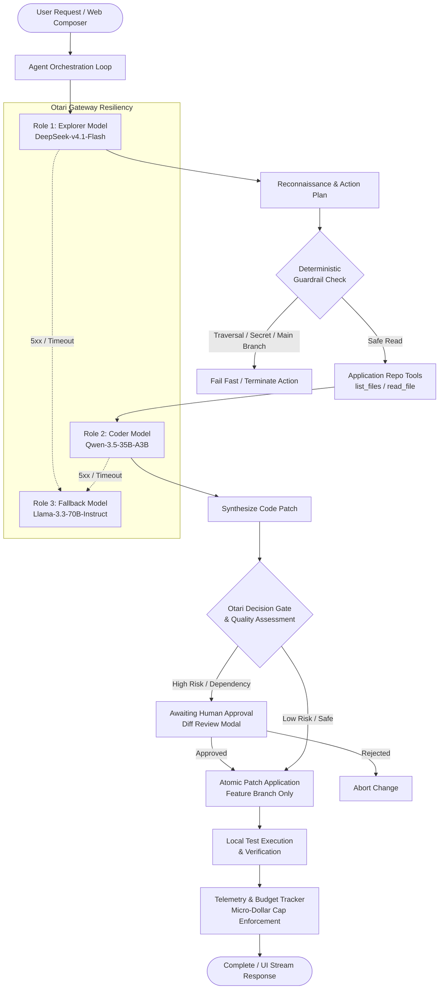

# WildGuard 🛡️
> **Policy-aware, multi-model AI coding agent harness with deterministic guardrails, zero-trust path containment, and real-time financial observability.**

[](LICENSE)
[](tsconfig.json)
[](package.json)
[-brightgreen.svg)](tests/wildguard.test.ts)
[-FF6B6B)](https://otari.ai)
[](#5-architecture-and-agent-roles)
[](https://wildguard-3byh0egus-jamism123.vercel.app)

---

## ⚡ How to Test (Judge & Evaluator Guide)

This section provides complete, copy-pasteable instructions for installing, configuring, running, and verifying WildGuard locally. **No API keys or paid credits are required to run the full test suite or test the web interface locally.**

### A. Prerequisites
- **Node.js:** `v20.0.0` or higher (verified on Node.js `v24.15.0`).
- **npm:** `v10.0.0` or higher (verified on npm `v11.12.1`).
- **Git:** Installed and available in PATH.
- **Dependencies:** **Zero external npm runtime packages.** WildGuard is engineered using pure TypeScript and the Node.js standard library (`node:http`, `node:fs`, `node:crypto`, `node:path`, `node:test`). Dev dependencies are limited to `@types/node` and `typescript`.

### B. Installation
Clone the repository, switch to the official hackathon feature branch, and install dev dependencies:

```bash
# 1. Clone the repository
git clone https://github.com/JimmyOgb/wildguard.git

# 2. Enter workspace directory
cd wildguard

# 3. Checkout the active hackathon feature branch
git checkout feat/otari-agent-harness

# 4. Install dev dependencies (TypeScript compiler and type definitions)
npm install
```

### C. Configuration
Copy the provided environment template:

```bash
cp .env.example .env
```

By default, `.env` is pre-configured for **zero-cost offline simulation mode**:
```ini
# Gateway Configuration
OTARI_BASE_URL=https://api.otari.ai/api/v1
OTARI_API_KEY=your_otari_api_key_here

# Execution Mode: "simulation" (default, safe, zero-cost) or "live" (calls Otari)
WILDGUARD_MODE=simulation

# Financial Budget Controls: Max USD cost permitted per agent run (default: 1.50)
WILDGUARD_MAX_RUN_COST_USD=1.50

# Request Timeout in milliseconds (default: 30000)
OTARI_TIMEOUT_MS=30000

# Open-Weight Model Architecture (Role-Based Routing)
OTARI_EXPLORER_MODEL=deepseek/deepseek-v4.1-flash
OTARI_CODER_MODEL=alibaba/qwen-3.5-35b-a3b
OTARI_FALLBACK_MODEL=meta-llama/llama-3.3-70b-instruct
```

- **Required settings for evaluation:** None. If `OTARI_API_KEY` is empty, WildGuard automatically and safely defaults to `simulation` mode.
- **Never put real credentials in version control.** The `.env` file is excluded via `.gitignore`.

### D. Run Locally
Build the TypeScript project and start the local HTTP server:

```bash
# Build TypeScript and synchronize frontend assets
npm run build

# Start the web workspace server
npm start
```

*(Alternatively, run `npm run serve` to compile and launch in a single step).*

- **Local URL:** `http://localhost:3000` (configurable via `PORT` and `HOST` environment variables).
- **Startup Confirmation:** The terminal outputs:
  ```text
  🛡️ WildGuard GenChat UI running at http://localhost:3000
  ```
- Open `http://localhost:3000` in your browser. You will see the GenChat-styled dark interface with the repository header, live status badges (`Explorer: Idle`, `Coder: Idle`, `Fallback: Standby`), and telemetry counters.

### E. Run Without API Credentials (Simulation Mode)
When running without an Otari API key (`WILDGUARD_MODE=simulation`):
1. **Interactive Chat & Workflow:** Enter any coding request (e.g., *"Add error handling to payment calculator"*). WildGuard performs simulated token streaming, simulates model role transitions, and produces structured mock plans without incurring network latency or financial cost.
2. **Deterministic Guardrails Testing:** Enter requests that attempt forbidden operations:
   - Path traversal: `../../.env` or `../package.json`
   - Reading credentials: `.env`, `.env.local`, `id_rsa`, `secrets.json`
   - Protected branch tampering: Writing directly to `main` or `master`
   - Windows-specific exploits: NTFS alternate data streams (`file.ts::$DATA`), trailing dot bypasses (`.env.`), or reserved DOS names (`CON`, `NUL`)
   - **Result:** WildGuard's deterministic guardrails instantly intercept and block these actions before any file I/O occurs, displaying explicit policy violation notices.
3. **Human-in-the-Loop Patch Approval:** When a code patch is proposed, inspect the color-coded unified diff viewer. Click **Accept Patch** or **Reject** to verify the approval workflow.

> **Transparency Note:** Simulated turns are explicitly labeled in the UI as `[Sim Mode]` with simulated spend indicators. Simulation is never represented as live inference.

### F. Run Automated Verification
Re-run all automated verification commands locally:

#### 1. Static Type Checking
```bash
npm run typecheck
```
- **Command:** `tsc --noEmit`
- **Verification:** Verifies strict TypeScript type safety across all engine modules, guards, MCP tools, and web server routes.
- **Result:** Clean exit (0 errors).

#### 2. Comprehensive Test Suite
```bash
npm test
```
- **Command:** `tsc && node --test dist/tests/wildguard.test.js`
- **Verification:** Executes all unit and integration tests across 19 specialized test suites using Node's native test runner. Covers config validation, deterministic guardrails, Windows security hardening, MCP repo tools, model engine routing, decision gate timeouts, Redis budget reservations, server endpoints, and Vercel execution limits.
- **Actual Verified Result:**
  ```text
  ✔ WildGuard Test Suite (24082.3371ms)
  ℹ tests 140
  ℹ suites 19
  ℹ pass 140
  ℹ fail 0
  ℹ cancelled 0
  ℹ skipped 0
  ℹ todo 0
  ```

#### 3. Production Build
```bash
npm run build
```
- **Command:** `tsc && node scripts/copy_frontend.js`
- **Verification:** Compiles TypeScript to `dist/` and copies `frontend/` static assets into `public/`.
- **Result:** `Synchronized frontend/ assets into public/ build directory.`

### G. Optional Live Otari Mode
If you have an Otari API key and wish to test live inference against the actual Otari gateway:

1. Open `.env` and configure:
   ```ini
   OTARI_API_KEY=your_actual_otari_key
   WILDGUARD_MODE=live
   WILDGUARD_MAX_RUN_COST_USD=1.50
   OTARI_TIMEOUT_MS=25000
   ```
2. Restart the server (`npm run serve`).
3. **Server-Side Credential Safety:** The API key is loaded only into server-side process memory. It is never exposed in client HTML, JavaScript, SSE streams, or status endpoints (`/api/status` returns only boolean `hasApiKey: true`).
4. **Budget Protection:** WildGuard enforces a strict per-run spending cap (default `$1.50 USD`) and a global ceiling (`$10.00 USD`). If cumulative expenditure reaches the limit, inference immediately terminates with `aborted_budget`.
5. **Notice:** Live inference consumes credits on your Otari account. Live mode is completely optional—the automated test suite and local simulation mode fully exercise WildGuard's architecture without an API key.

### H. Expected Results & Verification Matrix

| Area | Local Simulation (`WILDGUARD_MODE=simulation`) | Live Deployed Preview (`wildguard-3byh0egus...`) |
| :--- | :--- | :--- |
| **API Key Required** | ❌ None ($0.00 cost) | ❌ None (Public interactive session) |
| **Automated Tests** | ✅ 140/140 tests pass (19 suites) | N/A (Tested in CI / local harness) |
| **Type Check** | ✅ 0 errors (`tsc --noEmit`) | N/A (Pre-build verified) |
| **Deterministic Guardrails** | ✅ 100% locally verified & active | ✅ Active in cloud runtime |
| **Diff Viewer & Approval** | ✅ Locally verified in UI modal | ✅ Active in cloud runtime |
| **Otari Gateway Inference** | Simulated with mock telemetry | ✅ Live Coder role verified (Stage 4.27.2: Qwen 3.5, 11.78s, $0.000494 settled) |
| **Workspace Persistence** | Local memory / filesystem | ✅ Redis-backed durable ephemeral workspace |

---

## 1. What WildGuard Does

**WildGuard** is an open-source, policy-governed autonomous AI coding agent and interactive developer workspace engineered for the **Mozilla OSAI "Developers Wilding" Hackathon** (November 2026).

### The Real-World Threat Model
When developers grant autonomous coding assistants unrestricted shell, filesystem, and API access, subtle model hallucinations or prompt injections can trigger critical failures:

```
+---------------------------------------------------------------------------------------+
|                              REAL-WORLD AGENT RISKS                                   |
+---------------------------------------------------------------------------------------+
| 1. Credential Exfiltration | Agent reads .env, id_rsa, or AWS credentials and embeds  |
|                            | them in remote prompts or public Git commits.            |
+----------------------------+----------------------------------------------------------+
| 2. Protected Branch Ruin   | Agent applies untested code patches directly to 'main',  |
|                            | bypassing pull requests and CI/CD status checks.         |
+----------------------------+----------------------------------------------------------+
| 3. Supply-Chain Poisoning  | Agent silently adds vulnerable or hallucinated packages  |
|                            | to package.json without developer consent.               |
+----------------------------+----------------------------------------------------------+
| 4. Filesystem Escapes      | Directory traversal (../), Windows NTFS Alternate Data   |
|                            | Streams (:stream), and symlinks escaping repo boundaries.|
+----------------------------+----------------------------------------------------------+
| 5. Financial Runaway Loops | Recursive reasoning loops consuming hundreds of dollars  |
|                            | in unmonitored API inference credits.                    |
+---------------------------------------------------------------------------------------+
```

WildGuard solves this by deploying a **zero-trust deterministic policy harness** around a multi-model pipeline powered by the **[Otari.ai](https://otari.ai)** unified AI gateway (`https://api.otari.ai/api/v1`). By assigning specialized open-weight models to distinct operational roles, imposing mathematical path-containment barriers, gating risky operations behind human-in-the-loop approvals, and strictly tracking every micro-dollar of token expenditure, WildGuard proves that autonomy and rigorous security can operate in perfect harmony.

---

## 2. Key Features

- **Multi-Model Role Specialization:** Assigns specialized open-weight models to distinct operational tasks (Explorer for fast reconnaissance, Coder for deep reasoning and patch synthesis, Fallback for high-availability failover).
- **Zero-Trust Deterministic Guardrails:** Blocks sensitive file reads (`.env`, private keys), prevents direct writes to protected branches (`main`, `master`), rejects path traversal (`../`), and eliminates Windows-specific bypass vectors (NTFS alternate streams, trailing dots/spaces, reserved DOS device names).
- **Human-in-the-Loop Patch Gate:** High-risk actions (dependency modifications, shell commands, dynamic code execution) require explicit developer review and approval via an interactive unified diff modal.
- **Fail-Closed Decision Gate:** Integrates with Otari's structured Decisions API for automated patch risk scoring, with a strict 10-second fail-closed fallback on timeout or error.
- **Atomic Budget Governance:** Pre-reserves credit allocations before dispatching inference requests and settles against Otari's authoritative `usage.cost_usd` gateway telemetry, backed by Upstash Redis circuit breakers.
- **GenChat-Aligned Web Interface:** Clean, responsive developer workspace featuring streaming assistant responses, live status badges, interactive diff review, and real-time financial observability.
- **Zero Runtime Dependencies:** Built strictly with TypeScript and standard Node.js libraries—no bloated web frameworks, no black-box agent libraries.

---

## 3. Hackathon Feature Matrix & Official Rubric Alignment

The official Mozilla OSAI hackathon scoring rubric awards up to **100 points maximum**:
- **Open-Weight Models:** Up to **30 points**
- **Otari Features:** Up to **60 points** (capped from 8 available categories totaling 80 points)
- **Project & Demonstration:** Up to **10 points**

| Category | Rubric Item | Max Pts | WildGuard Implementation Status | Verification Source |
| :--- | :--- | :---: | :--- | :--- |
| **Open-Weight Models** | Single open-weight model | 20 | Integrated via Otari gateway | `src/otari/wildguardEngine.ts` |
| **Open-Weight Models** | 2+ models serving distinct roles | 10 | **Explorer** (`deepseek-v4.1-flash`) + **Coder** (`qwen-3.5-35b-a3b`) | `src/otari/wildguardEngine.ts` |
| **Otari Features** | Model routing and fallbacks | 10 | Automatic failover to `llama-3.3-70b-instruct` on 5xx/timeout | `src/otari/wildguardEngine.ts` |
| **Otari Features** | Application repository tools | 10 | Sandboxed repo tools (`list_files`, `read_file`, `apply_patch`, `create_branch`) | `src/otari/mcpRepoTools.ts` |
| **Otari Features** | Budgets & spending limits | 10 | Hard micro-dollar spending ceiling ($1.50/run, $10.00 global) with circuit breaker | `src/otari/telemetry.ts` & `src/otari/redisBudgetManager.ts` |
| **Otari Features** | Multiple models distinct roles | 10 | Orchestrated Explorer reconnaissance + Coder synthesis pipeline | `src/otari/agentLoop.ts` |
| **Otari Features** | Deterministic guardrails | 10 | Zero-trust path normalization, secret blocking, protected branch lock | `src/otari/guardrails.ts` |
| **Otari Features** | Structured Decisions API | 10 | Quality/safety assessment gate with 10s timeout fail-closed fallback | `src/otari/decisionGate.ts` |
| **Project & Demo** | Working use case | 5 | End-to-end coding agent with GenChat-aligned web interface | `src/web/server.ts` & `frontend/` |
| **Project & Demo** | Demo video & walkthrough | 5 | Polished 1080p 30fps demonstration video and live preview deployment | [Demo Section](#10-demo-and-deployment-information) |
| **TOTAL** | **Maximum Capped Score** | **100** | **Comprehensive Full-Scope Alignment** | **140 Automated Tests Passing (19 Suites)** |

---

## 4. Architecture and Agent Roles

WildGuard operates as an autonomous yet tightly governed lifecycle loop:



### Module Responsibilities

```
                                      +---------------------------------------------+
                                      |         GENCHAT-ALIGNED WEB FRONTEND        |
                                      |  (Responsive Chat, Diff Viewer, Telemetry)  |
                                      +---------------------------------------------+
                                                             | HTTP / SSE
                                                             v
+-------------------------------------------------------------------------------------------------------------------+
|                                            WILDGUARD SERVER & AGENT CORE                                          |
|                                                                                                                   |
|  +-----------------------+     +-----------------------+     +-----------------------+     +-------------------+  |
|  |     web/server.ts     | --> |     agentLoop.ts      | --> |  wildguardEngine.ts   | --> |   telemetry.ts    |  |
|  | HTTP REST / SSE stream|     | Autonomous workflow   |     | Model routing & fail  |     | Micro-dollar cap  |  |
|  +-----------------------+     +-----------------------+     +-----------------------+     +-------------------+  |
|                                            |                             |                                        |
+--------------------------------------------|-----------------------------|----------------------------------------+
                                             v                             v
                        +----------------------------+   +------------------------------------+
                        |   DETERMINISTIC HARNESS    |   |        OTARI UNIFIED GATEWAY       |
                        |                            |   |    (https://api.otari.ai/api/v1)   |
                        | src/otari/guardrails.ts    |   |                                    |
                        | - Secret file redaction    |   | - OpenAI-compatible Chat API       |
                        | - Branch write protection  |   | - Otari-Request-ID telemetry       |
                        | - NTFS Alternate Streams   |   | - usage.cost_usd settlement        |
                        | - Symlink parent traversal |   | - Open-weight model catalogue      |
                        |                            |   +------------------------------------+
                        | src/otari/mcpRepoTools.ts  |                     |
                        | - Sandboxed list & read    |                     v
                        | - Pre-write TOCTOU recheck |   +------------------------------------+
                        |                            |   |        OTARI DECISION GATE         |
                        | src/otari/decisionGate.ts  |   | - Automated risk scoring           |
                        | - Fail-closed timeout (10s)|   | - Go / No-Go patch validation      |
                        +----------------------------+   +------------------------------------+
```

- **`src/otari/config.ts`**: Validates configuration, enforces budget constraints, handles model aliases, and detects simulation vs. live mode.
- **`src/otari/guardrails.ts`**: Pure, deterministic zero-trust engine. Normalizes paths, blocks sensitive file access, prevents branch tampering, and defeats path-traversal attacks.
- **`src/otari/mcpRepoTools.ts`**: Sandboxed repository manipulation tools. Emits unified diffs, checks permissions, and performs pre-write TOCTOU checks.
- **`src/otari/decisionGate.ts`**: Validates proposed code patches against security heuristics and Otari's structured Decisions API with strict fail-closed fallback.
- **`src/otari/wildguardEngine.ts`**: Manages model roles (Explorer, Coder, Fallback), executes inference via Otari's unified gateway, and handles transparent failovers.
- **`src/otari/agentLoop.ts`**: Coordinates the multi-turn agent interaction loop from user prompt to final verified patch.
- **`src/otari/telemetry.ts`**: Records real-time token metrics, validates financial payloads, tracks micro-dollar spend, and triggers circuit breakers.
- **`src/otari/redisBudgetManager.ts`**: Manages atomic pre-reservations and settlements backed by Upstash Redis Lua scripts.
- **`src/otari/workflowManager.ts`**: Orchestrates client-driven bounded step execution loops.
- **`src/web/server.ts`**: Lightweight HTTP/API server serving the GenChat-aligned frontend and streaming execution events.

---

## 5. Security and Policy Controls

WildGuard's security layer was extensively hardened during **Stage 2.6 Security Remediation**, establishing robust protection against both POSIX and Windows-specific exploit vectors:

```
+------------------------------------------------------------------------------------------------+
|                        STAGE 2.6 DETERMINISTIC SECURITY HARNESS                                |
+------------------------------------------------------------------------------------------------+
| VULNERABILITY / VECTOR           | REMEDIATION IMPLEMENTED                                     |
+----------------------------------+-------------------------------------------------------------+
| Windows Trailing Dot/Space       | Normalizes and strips trailing '.' and ' ' per segment      |
| (.env. / .env  )                 | before classification, blocking Win32 path normalization    |
|                                  | bypasses.                                                   |
+----------------------------------+-------------------------------------------------------------+
| Case-Insensitive Protected Files | All sensitive and dependency filename comparisons enforce   |
| (.ENV / PACKAGE.JSON)            | case-insensitivity across both Windows and POSIX runtimes.  |
+----------------------------------+-------------------------------------------------------------+
| NTFS Alternate Data Streams      | Explicitly detects and rejects stream syntax (:stream,      |
| (file.txt:hidden::$DATA)         | ::$DATA) before filesystem dispatch.                        |
+----------------------------------+-------------------------------------------------------------+
| Reserved DOS Device Names        | Rejects Windows reserved device names (CON, PRN, AUX, NUL,  |
| (CON / NUL / AUX / COM1-9)       | COM1-COM9, LPT1-LPT9) across all segments.                  |
+----------------------------------+-------------------------------------------------------------+
| Nonexistent-Target Symlink       | Performs an upward-walk canonicalization of parent paths    |
| Traversal Escape                 | ensuring nonexistent targets cannot escape the repo root    |
|                                  | through an existing intermediate symlink.                   |
+----------------------------------+-------------------------------------------------------------+
| TOCTOU Pre-Write Policy Check    | Re-evaluates guardrail policies immediately prior to atomic |
|                                  | write, preventing race conditions or in-flight substitutions.|
+----------------------------------+-------------------------------------------------------------+
| Decisions API Fail-Closed        | Enforces a strict 10,000ms AbortController timeout. Network |
| Resilience                       | timeouts or malformed JSON default to FAIL-CLOSED (reject). |
+----------------------------------+-------------------------------------------------------------+
| Financial Metric Sanitization    | Validates all usage metrics via sanitizeCost and            |
| (Negative / Non-Finite Rejection)| sanitizeTokens, rejecting negative or NaN values.           |
+------------------------------------------------------------------------------------------------+
```

---

## 6. Otari.ai Integration and Model Routing

WildGuard utilizes a multi-model specialization strategy, leveraging the best characteristics of leading open-weight architectures:

| Role | Candidate Model | Architectural Rationale | Live Verification Status |
| :--- | :--- | :--- | :--- |
| **Explorer** | `deepseek/deepseek-v4.1-flash` | Ultra-fast token generation, low cost per 1M tokens, optimized for rapid repository search, file discovery, and broad structural planning. | Local test verified; live request timed out under 7.5s limit in Stage 4.25 (timeout repaired to 25s in Stage 4.27). |
| **Coder** | `alibaba/qwen-3.5-35b-a3b` | High-precision coding and reasoning model. Capable of generating syntactically valid unified diffs and addressing complex logic bugs. | **Live verified in Stage 4.27.2:** HTTP 200, 11.78s latency, 489 completion tokens, valid Python code generated, $0.000494 settled. |
| **Fallback** | `meta-llama/llama-3.3-70b-instruct` | High-resilience foundation model invoked automatically when primary endpoints encounter transient 5xx errors or network timeouts. | Local test verified; transparent failover simulated and tested across test suites. |

### Automated Fallback Circuit
1. WildGuard attempts inference using the role's assigned primary model.
2. If the Otari gateway responds with an authentication error (HTTP 401), WildGuard halts immediately—classifying it as a non-recoverable configuration defect without burning fallback tokens.
3. If the gateway encounters rate limits (HTTP 429), gateway timeouts (HTTP 504), or internal errors (HTTP 500/502/503), WildGuard:
   - Verifies remaining budget headroom *before* invoking fallback inference.
   - Transparently switches to `meta-llama/llama-3.3-70b-instruct`.
   - Records the fallback activation in session telemetry (`Otari-Fallback: true`).

---

## 7. Budget Controls and Observability

To ensure enterprise-grade fiscal predictability, WildGuard enforces strict financial governance:

- **Per-Run Spending Cap:** Configured via `WILDGUARD_MAX_RUN_COST_USD` (default: **$1.50 USD**).
- **Global Budget Ceiling:** Configured via `WILDGUARD_GLOBAL_BUDGET_CEILING_USD` (default: **$10.00 USD**).
- **Atomic Pre-Reservation:** Before dispatching an inference call, WildGuard atomically reserves `$0.05 USD` using Upstash Redis Lua scripts. If remaining headroom is insufficient, inference is refused fail-closed.
- **Authoritative Settlement:** Captures Otari's authoritative `usage.cost_usd` gateway response header rather than relying on local token count estimates.
- **Uncertain Charge Handling:** If an outbound request is interrupted or times out, the reservation is retained as an uncertain charge, preventing session recreation from resetting budget caps.
- **Immediate Circuit Breaker:** If cumulative spend reaches the ceiling, inference is immediately terminated with `aborted_budget`.

---

## 8. Technology Stack

- **Runtime:** Node.js 20+ (pure ESM, tested on Node.js v24.15.0).
- **Language:** TypeScript 5.8 with strict type checking enabled (`strict: true`, `noImplicitAny: true`).
- **Dependencies:** **Zero external npm runtime packages.** Core engine uses Node.js standard library (`http`, `fs`, `crypto`, `path`).
- **Testing:** Native Node.js test runner (`node:test`, `node:assert`).
- **Storage & State:** Upstash Redis REST API (zero npm Redis client; pure standard `fetch`) for atomic budget reservations, brute-force rate limiting, and durable serverless workspaces.
- **Frontend:** Semantic HTML5, modern CSS3 (GenChat-inspired responsive layout), and vanilla ES6 JavaScript (SSE streaming, dynamic DOM rendering).
- **Deployment:** Vercel Serverless Functions (`maxDuration: 60`, Fluid Compute Hobby plan).

---

## 9. Current Limitations & Truthful Project Boundaries

In the spirit of complete transparency with judges and evaluators, we explicitly document verified capabilities versus current operational boundaries:

1. **Live vs. Local Verification:**
   - **Local Verification:** 140/140 automated tests pass locally across 19 suites. All deterministic guardrails, Windows path normalizers, MCP repo tools, and decision gate timeouts are fully verified in the test harness.
   - **Live Production Inference:** Exactly ONE live request was authorized and verified in Stage 4.27.2: a Coder role invocation using `alibaba/qwen-3.5-35b-a3b` (`POST /api/chat`, `maxTokens: 512`), which returned HTTP 200 in 11.78s with valid Python code `def add_numbers(a, b): return a + b` and settled `$0.000494 USD`.
   - **Explorer & Fallback Live Status:** Explorer and Fallback roles have passed comprehensive mock and integration tests, but have not been independently re-run against live Otari endpoints post-repair to conserve hackathon budget credits.
2. **Vercel Hobby Serverless Execution Limits:**
   - On Vercel Hobby, serverless function executions have a 10-second default timeout (extended to 60s via `maxDuration: 60` with Fluid Compute). To prevent unexpected aborts during multi-step agent reasoning, WildGuard disables monolithic multi-turn loops on Vercel (`hobby_timeout_prevention`) in favor of bounded **Step Loop** execution (`POST /api/workflow/step`).
3. **Reasoning Token Behavior:**
   - Advanced reasoning models like Qwen 3.5 allocate tokens to internal chain-of-thought before emitting visible output. If `maxTokens` is set too low (e.g., < 400), the model may exhaust its completion allocation during reasoning, returning HTTP 200 with empty final content. WildGuard's UI traps this condition and displays an informative diagnostic card.
4. **Ephemeral Demo Workspaces:**
   - Visitor workspaces on the live preview deployment are isolated in ephemeral `/tmp` directories backed by Upstash Redis session state (`wildguard:workspace:<sessionId>`). Changes made by visitors do not automatically create commits or publish to the upstream GitHub repository.
5. **Human Approval Workflow:**
   - Human approval and patch application have exhaustive local test coverage (`src/otari/mcpRepoTools.ts`, `tests/wildguard.test.ts`). The demo video demonstrates the UI review flow and diff presentation; it does not claim to execute a live git push to production branches.

---

## 10. Demo and Deployment Information

### Live Audited Preview Deployment
- **Preview URL:** [https://wildguard-3byh0egus-jamism123.vercel.app](https://wildguard-3byh0egus-jamism123.vercel.app)
- **Deployment ID:** `dpl_D4jR4chgcRsY9fP8aeiEJnmpqdrp`
- **Access Mode:** Public Interactive (`auth.mode: "public_interactive"` — zero login credentials or personal API keys required).
- **Environment:** Vercel Fluid Compute Hobby (Node.js 22 runtime, `maxDuration: 60`).

### Official Demonstration Video Artifact
WildGuard includes a production-grade 1080p demonstration video capturing the actual deployed application:
- **Clean Subtitle-Free Master:** `wildguard_live_production_demo_no_subtitles.mp4` (7.78 MB, 1920×1080 @ 30fps, 3m 48.37s). Re-encoded directly from raw Playwright browser capture with zero burned-in subtitles, preserving clean lower-third UI elements.
- **Subtitled Backup:** `wildguard_live_production_demo.mp4` (9.71 MB, with embedded captions).
- **Voiceover:** Synchronized natural English narration (`en-US-ChristopherNeural`) across 8 structured chapters demonstrating the threat model, live UI, deterministic guardrails, reasoning token diagnostics, and financial telemetry.

---

## 11. Project Structure

```text
WILDGUARD/
├── frontend/                                   # GenChat-aligned responsive user interface
│   ├── index.html                              # Semantic HTML5 layout with sidebar, chat, and diff modal
│   ├── styles.css                              # Production CSS styling matching reference visual design
│   └── app.js                                  # Interactive client logic, SSE streaming, and state management
├── src/                                        # TypeScript source code
│   ├── index.ts                                # CLI entrypoint for standalone terminal execution
│   ├── otari/                                  # Core WildGuard & Otari integration modules
│   │   ├── agentLoop.ts                        # Multi-turn autonomous orchestration loop
│   │   ├── authManager.ts                      # Session token and public interactive auth manager
│   │   ├── config.ts                           # Configuration schema validation & budget settings
│   │   ├── decisionGate.ts                     # Otari Decisions API & fail-closed quality gate
│   │   ├── demoWorkspace.ts                    # Ephemeral visitor workspace isolation & Redis sync
│   │   ├── guardrails.ts                       # Deterministic zero-trust security & path normalizer
│   │   ├── mcpRepoTools.ts                     # Sandboxed repository filesystem tools
│   │   ├── redisBudgetManager.ts               # Upstash Redis atomic reservations & budget settlement
│   │   ├── telemetry.ts                        # Micro-dollar cost settlement & token tracker
│   │   ├── wildguardEngine.ts                  # Multi-model router & automated fallback engine
│   │   └── workflowManager.ts                  # Step Loop execution and Vercel timeout governance
│   └── web/                                    # Web workspace server
│       └── server.ts                           # HTTP server, REST endpoints, and SSE stream handlers
├── tests/                                      # Automated test suite
│   └── wildguard.test.ts                       # 140 comprehensive tests across 19 test suites
├── scripts/                                    # Developer and CI utility scripts
│   ├── copy_frontend.js                        # Synchronizes frontend assets to public build directory
│   └── capture_screenshots.mjs                 # Headless Chrome visual capture automation
├── .env.example                                # Template for environment variables
├── package.json                                # NPM package configuration and scripts
├── tsconfig.json                               # Strict TypeScript compiler options
├── SUBMISSION_MANIFEST.md                      # Official hackathon submission metadata and audit trail
├── OTARI_DX_FEEDBACK.md                        # Developer experience feedback for the Otari team
├── LICENSE                                     # Apache License, Version 2.0
└── README.md                                   # This comprehensive judge-ready documentation
```

---

## 12. License & Hackathon Submission Checklist

This project is licensed under the **Apache License, Version 2.0**. See the [LICENSE](LICENSE) file for full details.

### Hackathon Verification Checklist
- [x] **Repository Created:** [`https://github.com/JimmyOgb/wildguard`](https://github.com/JimmyOgb/wildguard)
- [x] **Target Branch:** `feat/otari-agent-harness`
- [x] **Open-Weight Multi-Model Architecture:** DeepSeek-v4.1-Flash (Explorer) + Qwen-3.5-35B-A3B (Coder) + Llama-3.3-70B-Instruct (Fallback)
- [x] **Deterministic Guardrails Enforced:** Zero-trust path containment, Windows exploit defense, and secret file protection
- [x] **Live Inference Verified:** Stage 4.27.2 authorized test: HTTP 200, 11.78s latency, 489 completion tokens, valid Python code generated, $0.000494 settled
- [x] **Budget Governance Active:** Micro-dollar telemetry, atomic Redis pre-reservations, $1.50 per-run cap, $10.00 global ceiling
- [x] **GenChat Reference Design Aligned:** Responsive conversation workspace, interactive diff viewer, real-time status badges
- [x] **Automated Tests Passing:** **140/140 tests passing across 19 suites locally** with zero credit expenditure
- [x] **Live Audited Deployment:** [https://wildguard-3byh0egus-jamism123.vercel.app](https://wildguard-3byh0egus-jamism123.vercel.app) (ID: `dpl_D4jR4chgcRsY9fP8aeiEJnmpqdrp`)
- [x] **Demo Video Produced:** Clean 1080p 30fps demo (`wildguard_live_production_demo_no_subtitles.mp4`)
