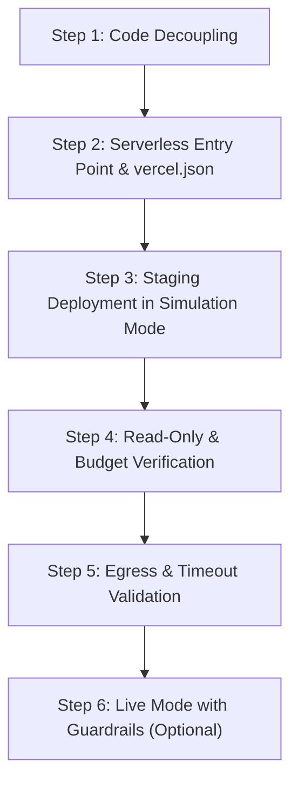

# WildGuard — Stage 4.0 Vercel Production Readiness Audit Report

**Workspace:** `C:\Users\NO GO NO\WILDGUARD`  
**Audit Date:** 2026-11-02  
**Audit Nature:** Comprehensive, Read-Only Production & Architecture Assessment  
**Target Platform:** Vercel (Edge Network & Serverless Functions)  
**Security Posture:** Zero live requests dispatched; zero credential values inspected or exposed; zero files or dependencies altered.

---

## 1. Executive Verdict

### **VERDICT: NOT READY** (for Live Production Deployment)
*(Conditionally **READY WITH ARCHITECTURAL ADAPTATIONS** for a restricted, simulation-only public preview).*

### Summary of Disqualifying Blockers:
1. **Server Architecture Mismatch:** WildGuard is packaged as a stateful, long-running Node.js daemon using native `node:http` with `server.listen()`. Vercel serverless architecture does not execute persistent daemons without dedicated serverless function adapters (`api/` directory entry points or `vercel.json` rewrites).
2. **Read-Only Filesystem in Serverless Functions (`EROFS`):** The repository tools module (`McpRepoTools.applyPatch()`) attempts to write directly to the local repository root (`fs.writeFileSync`). On Vercel Functions, the application root is strictly read-only, which will throw immediate runtime errors upon any patch application attempt.
3. **Statelessness Breaching Budget Guardrails:** The telemetry and budget cap tracker (`TelemetryManager`) stores spent USD and token balances entirely in volatile in-memory instance variables. Across Vercel serverless cold starts and multi-region invocations, this state is lost. Consequently, the hard **$1.50 per-run spending cap is completely bypassed**, creating unbounded financial risk if deployed live.
4. **Serverless Execution Timeout Contradiction:** WildGuard's autonomous agent loop executes multiple sequential LLM turns (Explorer $\rightarrow$ Coder $\rightarrow$ Decision Gate). The configured client timeout is **30,000 ms** (`OTARI_TIMEOUT_MS`). However, Vercel Hobby serverless functions enforce a strict **10-second** hard execution ceiling. Even a single slow or failing upstream call (such as Stage 3.12's 10,829 ms transport drop) will trigger an unhandled `504 FUNCTION_INVOCATION_TIMEOUT`.
5. **Unauthenticated Public Endpoint Exposure:** The HTTP API lacks any authentication, rate limiting, or session authorization. Exposing `POST /api/chat` and `POST /api/verify` with a live `OTARI_API_KEY` on a public Vercel domain allows arbitrary internet actors to trigger unmetered inference and exhaust the operator's account.
6. **Unresolved Upstream Transport Instability:** Stage 3.12 verified that an outbound connection to `https://otari.ai/api/v1/chat/completions` failed after 10.8s with HTTP 503 / `fetch failed`. Egress from Vercel's datacenter IP ranges (AWS Lambda) through upstream Cloudflare/bot mitigation remains unverified.

---

## 2. Current Framework and Deployment Architecture

| Component | Current Implementation | Characteristics |
| :--- | :--- | :--- |
| **Runtime Environment** | Node.js (ES2022 / `NodeNext` ESM) | Pure native Node.js built-ins (`node:http`, `node:fs`, `node:path`) |
| **Web Framework** | None (Vanilla `http.createServer`) | Zero external web frameworks (no Express, Fastify, Next.js, or Hono) |
| **Dependencies** | 0 production dependencies | Only `@types/node` and `typescript` in `devDependencies` |
| **Server Entry Point** | `dist/src/web/server.js` | Invoked directly via `node dist/src/web/server.js` |
| **Lifecycle Model** | Persistent long-running process | Calls `server.listen(port, host)` binding to port 3000 |
| **Routing** | Manual URL pathname pattern matching | Explicit matching on `pathname === '/api/...'` |
| **Frontend Serving** | Local filesystem streaming | `fs.createReadStream` piped from `frontend/` directory |
| **Build Artifacts** | `dist/` directory generated by `tsc` | Contains compiled `.js`, `.d.ts`, and `.map` files |

---

## 3. Vercel Compatibility Assessment

| Vercel Architectural Dimension | WildGuard State | Compatibility | Impact / Technical Analysis |
| :--- | :--- | :--- | :--- |
| **Static CDN Hosting** | `frontend/` (HTML, CSS, JS) | **COMPATIBLE (With Config)** | Static UI files can be served directly from Vercel's Global Edge Network, but require path mapping since files reside in `frontend/` rather than standard `public/`. |
| **Serverless Execution** | `src/web/server.ts` | **INCOMPATIBLE** | Vercel expects exported function handlers (`export default function handler(req, res)`). Calling `server.listen()` in a serverless function is a critical anti-pattern. |
| **Execution Duration (Timeout)** | 30s timeout configured | **INCOMPATIBLE (Hobby)** / **AT RISK (Pro)** | Hobby plan has a strict 10s maximum duration. The autonomous multi-model loop takes 15–45s. Live calls exceeding 10s will terminate abruptly. |
| **Filesystem Write Operations** | `fs.writeFileSync` in `applyPatch` | **INCOMPATIBLE** | Vercel serverless containers provide a read-only root filesystem. Writes outside `/tmp` throw `EROFS: read-only file system`. |
| **Filesystem Read Operations** | `fs.readdirSync`, `fs.readFileSync` | **PARTIALLY COMPATIBLE** | Repository file browsing (`/api/repo/files`) expects local disk presence. Vercel functions only bundle traced files unless explicitly included via `includeFiles`. |
| **In-Memory State & Concurrency** | In-memory `TelemetryManager` | **INCOMPATIBLE** | Instances are ephemeral and scale horizontally across requests; in-memory budget and session counters do not synchronize. |
| **Streaming / WebSockets** | Monolithic buffered JSON | **N/A (Not Used)** | WildGuard does not currently use WebSockets or SSE; all responses are single JSON payloads (`sendJson`). |

---

## 4. Serverless Migration Requirements

To transform WildGuard from a long-running standalone Node server into a Vercel-compatible serverless architecture, the following adaptations are required:

### 4.1 Serverless Function Entry Point Adapter
Instead of executing `http.createServer().listen()`, the HTTP request processing logic must be exported as an entry point function matching the Vercel Node.js signature:
```typescript
// Proposed adapter: api/index.ts
import type { VercelRequest, VercelResponse } from '@vercel/node';
// Adapter dispatches incoming (req, res) directly to WildGuard request handler without calling listen()
```

### 4.2 Routing Configuration (`vercel.json`)
A declarative Vercel configuration must be introduced to route frontend assets to Edge static caching and API calls to the serverless function:
```json
{
  "version": 2,
  "rewrites": [
    { "source": "/api/(.*)", "destination": "/api/index.js" },
    { "source": "/(.*)", "destination": "/frontend/$1" }
  ]
}
```

### 4.3 Execution Timeout Configuration (Pro Plan Required)
Because inference through multi-model routing regularly exceeds 10 seconds:
```json
{
  "functions": {
    "api/index.js": {
      "maxDuration": 60
    }
  }
}
```
*(Note: `maxDuration > 10` requires a Vercel Pro or Enterprise subscription. On free Hobby tiers, 10 seconds is the immutable platform ceiling).*

---

## 5. API Route Compatibility

| Endpoint | Method | Local Behavior | Vercel Serverless Behavior | Status |
| :--- | :--- | :--- | :--- | :--- |
| `/api/status` | `GET` | Returns sanitized config, telemetry, branch, repoRoot | Returns status, but `telemetry` will only reflect the current instance's lifetime (resets on cold start). | **PARTIALLY COMPATIBLE** |
| `/api/repo/files` | `GET` | Scans local filesystem directory tree | Will only see files packaged into the serverless bundle; external repo files will be missing unless bundled. | **PARTIALLY COMPATIBLE** |
| `/api/repo/file` | `GET` | Reads local file contents subject to guardrails | Reads bundled files successfully; blocks missing or unbundled files. | **PARTIALLY COMPATIBLE** |
| `/api/verify` | `GET/POST` | Executes single outbound call (no fallback) | Compatible, but will fail with 504 Gateway Timeout if Otari takes >10s on Hobby tier. | **CONDITIONAL** |
| `/api/chat` | `POST` | Runs single turn or multi-step autonomous loop | **Fails** on multi-step loops due to 10s Hobby timeout; runs fine in simulation mode (<200ms). | **HIGH RISK** |
| `/api/patch/apply` | `POST` | Writes new code to disk via `fs.writeFileSync` | **Fails with `EROFS`** (Read-only filesystem error) when attempting to write to project root. | **INCOMPATIBLE** |
| `/api/tests/run` | `POST` | Returns deterministic mock test suite status | Executes synchronously in-memory (~77ms). | **COMPATIBLE** |

---

## 6. Persistent Storage and Session Risks

### 6.1 Telemetry & Spending Cap Vulnerability
- **Mechanism:** `TelemetryManager` maintains `accumulatedActualCostUsd` and `events[]` in local memory.
- **Risk:** In serverless, invocations are routed across dynamic, stateless containers. Every cold start creates a fresh `agent` instance with `$0.000000 USD` accumulated spend.
- **Consequence:** An attacker or high-volume client can send hundreds of requests across parallel instances. The application will never perceive that the $1.50 per-run cap has been breached, defeating the core financial safety guarantee.
- **Remediation Requirement:** Persistent centralized storage (e.g., Vercel KV, Redis, or an external database) is required to track budget caps reliably in serverless environments.

### 6.2 Feature Branch & Git Workspace Immutability
- **Mechanism:** `McpRepoTools.currentBranch` is stored in an in-memory string variable (`feat/otari-agent-harness`).
- **Risk:** Creating or switching branches via `/api/chat` or `tools.createBranch()` only alters local container memory. It does not manipulate Git refs and is immediately discarded when the container spins down.

### 6.3 Patch Application Failure
- **Mechanism:** In local mode, `applyPatch` modifies disk files and generates diff previews.
- **Risk:** In Vercel Functions, any file modification in the repository directory will trigger an unhandled rejection:
  ```text
  Error: EROFS: read-only file system, open '.../package.json'
  ```
- **Remediation Requirement:** In serverless environments, patches must either be returned purely as proposed diffs (in-memory dry run) or committed to a remote Git provider via API (e.g., GitHub Octokit), rather than written to local disk.

---

## 7. Environment Variable Configuration Plan

To deploy safely, environment variables must be configured via the Vercel Project Settings dashboard. They must **never** be checked into the repository or included in build artifacts.

| Variable Name | Required Scope | Recommended Production Value | Purpose / Description |
| :--- | :--- | :--- | :--- |
| `WILDGUARD_MODE` | Server Only | `simulation` (Default / Staging) or `live` | Controls whether external Otari API calls are permitted. |
| `OTARI_API_KEY` | Server Only (Encrypted) | Operator Secret Value | API key for Otari gateway. Strictly hidden from client bundles. |
| `OTARI_BASE_URL` | Server Only | `https://api.otari.ai/api/v1` | Official Otari API base endpoint. |
| `OTARI_TIMEOUT_MS` | Server Only | `9000` (Hobby) or `25000` (Pro) | Must be configured strictly lower than Vercel's `maxDuration`. |
| `WILDGUARD_MAX_RUN_COST_USD` | Server Only | `1.50` | Maximum spend ceiling per run. |
| `OTARI_EXPLORER_MODEL` | Server Only | `deepseek/deepseek-v4.1-flash` | Role model for exploration & planning. |
| `OTARI_CODER_MODEL` | Server Only | `alibaba/qwen-3.5-35b-a3b` | Primary role model for code generation. |
| `OTARI_FALLBACK_MODEL` | Server Only | `meta-llama/llama-3.3-70b-instruct` | Standby failover model. |

### Client-Side Exposure Safeguards:
- No variable begins with `NEXT_PUBLIC_` or `VITE_`.
- `src/otari/config.ts` sanitizes all output sent via `/api/status`, transmitting only `hasApiKey: boolean` and never the key itself.
- `src/otari/guardrails.ts` continues to block any read requests attempting to inspect `.env` files.

---

## 8. Security Findings

1. **Missing Ingress Authentication (High Risk):**  
   The HTTP server has no authentication layer (no session cookies, JWTs, or API bearer tokens). Anyone who visits the deployment URL can interact with all endpoints. If deployed in `live` mode, this allows unauthorized public consumption of paid API credits.
2. **Permissive CORS Header (Medium Risk):**  
   `src/web/server.ts` injects `Access-Control-Allow-Origin: *` unconditionally. Any external web page loaded in an operator's browser could issue cross-origin requests to the WildGuard instance.
3. **Denial of Service via Payload Size (Low-Medium Risk):**  
   `server.ts` limits request bodies to 5MB, which is reasonable, but unauthenticated repeated POST requests could saturate serverless function quotas.
4. **Credential Isolation (Positive Finding):**  
   The application demonstrates excellent defensive coding: `OTARI_API_KEY` is never reflected in logs, error messages are scrubbed via `sanitizeErrorMessage()`, and `.env` is blocked by path policies.

---

## 9. Build and Runtime Findings

- **Build Script:** `"build": "tsc"` compiles TypeScript cleanly with zero errors. Output is placed in `dist/`.
- **Typecheck Script:** `"typecheck": "tsc --noEmit"` passes with zero diagnostic errors.
- **Module Format:** ES Modules (`"type": "module"` in `package.json`, `"module": "NodeNext"` in `tsconfig.json`). Vercel natively supports Node.js ESM.
- **Dependencies:** 0 runtime npm dependencies. This results in ultra-fast deployment builds and minimal serverless bundle sizes (<1MB).
- **Execution Engine:** Native `fetch` and `AbortController` require Node.js 18+. Vercel defaults to Node.js 20.x, which is fully compatible.

---

## 10. Otari Connectivity Assessment

Distinguishing strictly between verified runtime facts and deployment assumptions:

### Verified Facts (Empirically Observed):
1. **Stage 3.8 Transport Success:** An outbound request from the local environment to `https://otari.ai/api/v1/chat/completions` succeeded with `HTTP 200 OK` in 7,312 ms using model `alibaba/qwen-3.5-35b-a3b`.
2. **Stage 3.8 Content Anomaly:** The gateway returned HTTP 200, but all 100 completion tokens were consumed by the upstream model's thinking process, leaving `message.content` empty string (`""`).
3. **Stage 3.12 Transport Failure:** An outbound request to `https://otari.ai/api/v1/chat/completions` using model `meta-llama/llama-3.3-70b-instruct` failed after 10,829 ms with `fetch failed` (HTTP 503 / `network_error`).
4. **Gateway Invariant Enforcement:** In both Stage 3.8 and Stage 3.12, WildGuard dispatched exactly **one** outbound POST request, with zero retries and zero unauthorized fallback requests.

### Assumptions & Unknowns (Unverified in Vercel Cloud Environment):
1. **Datacenter IP Egress Filtering:** Vercel functions execute in AWS/GCP regions. Upstream DDoS / Cloudflare protections fronting `otari.ai` may challenge or block AWS Lambda datacenter IP ranges with CAPTCHA or Cloudflare Turnstile, which would cause immediate `fetch failed` errors.
2. **Canonical Hostname Discrepancy:** The repository documentation and `.env.example` specify `https://api.otari.ai/api/v1`, whereas Stage 3.8 and Stage 3.12 verified requests against `https://otari.ai/api/v1`. Whether both domains route identically or have disparate firewall configurations is unverified.
3. **Network Latency Overhead:** Otari gateway responses currently take 7–11 seconds. When executed from Vercel serverless functions, added container spin-up and routing latency will push roundtrip times dangerously close to Vercel platform timeouts.

---

## 11. Exact Files That Would Need Modification

If approval were granted in a subsequent stage to adapt WildGuard for Vercel, the following files would require specific modifications:

1. **`vercel.json` (New File):**  
   Required to configure static asset routing for `frontend/` and route `/api/*` to the serverless function handler.
2. **`api/index.ts` (New File):**  
   Required to provide a serverless export handler (`export default async function handler(req: VercelRequest, res: VercelResponse)`) that processes requests without invoking `http.createServer().listen()`.
3. **`src/web/server.ts`:**  
   Extract the request dispatch logic from `http.createServer()` into a reusable request-handler function that can be imported by both the local server CLI and the Vercel serverless function entry point.
4. **`src/otari/mcpRepoTools.ts`:**  
   Implement an execution check or read-only mode so that `applyPatch` does not attempt `fs.writeFileSync` in environments where the filesystem is read-only (`process.env.VERCEL === '1'`), returning an in-memory preview diff instead.
5. **`src/otari/telemetry.ts`:**  
   Add a warning or persistence abstraction indicating that budget state will not persist across serverless invocations unless backed by external storage.
6. **`frontend/app.js`:**  
   Remove hardcoded assumption that patches are committed to local disk; display appropriate serverless messaging when running on Vercel.

---

## 12. Minimal, Ordered Deployment Plan (If Authorized Later)

*Note: This plan is outlined for future execution. No actions have been taken during this audit.*



1. **Step 1 — Decouple Server Handler:** Refactor `src/web/server.ts` into a pure dispatch handler: `handleWildGuardRequest(req, res, agent)`.
2. **Step 2 — Implement Vercel Entry Point & Config:** Create `api/index.ts` and `vercel.json` mapping static files from `frontend/` and `/api/*` to the serverless function.
3. **Step 3 — Deploy Staging in Simulation Mode:**
   - Set `WILDGUARD_MODE=simulation`.
   - Leave `OTARI_API_KEY` unset.
   - Deploy to a private Vercel preview URL.
   - Verify that all static assets, `/api/status`, and simulated chat turns execute within <300ms.
4. **Step 4 — Verify Read-Only Safeguards:** Ensure `/api/patch/apply` gracefully handles the read-only filesystem without throwing uncaught 500 exceptions.
5. **Step 5 — Probe Egress Connectivity (Controlled Preflight):** Verify whether a test function on Vercel can resolve and connect to `https://api.otari.ai/api/v1` without Cloudflare blocking.
6. **Step 6 — Live Mode Decision Gate:** Only enable `WILDGUARD_MODE=live` and supply `OTARI_API_KEY` if:
   - Function execution timeout is set to at least 30s (Vercel Pro).
   - Ingress access control or basic authentication is implemented to prevent public credit draining.

---

## 13. Risks and Rollback Considerations

| Risk Category | Severity | Description | Mitigation / Rollback Procedure |
| :--- | :--- | :--- | :--- |
| **Financial Exposure** | **CRITICAL** | Public deployment with live key allows anyone to drain Otari credits; in-memory cap does not persist across serverless containers. | **Never set `WILDGUARD_MODE=live` on public Vercel without ingress authentication.** Rollback: delete `OTARI_API_KEY` from Vercel dashboard immediately. |
| **Execution Timeouts** | **HIGH** | Function terminations returning HTTP 504 on Hobby plan when Otari requests take >10s. | Set `OTARI_TIMEOUT_MS=9000` or upgrade to Vercel Pro with `maxDuration: 60`. Rollback: return to simulation mode. |
| **Filesystem Write Crashes** | **MEDIUM** | Applying patches in UI will crash with `EROFS`. | Trap `EROFS` in `mcpRepoTools.ts` and return simulation diff preview without writing to disk. |
| **Rollback Strategy** | **LOW** | Need to revert deployment immediately. | Vercel provides instant 1-click deployment rollback to the previous immutable deployment hash via dashboard or CLI (`vercel rollback`). |

---

## 14. Audit Conclusion & Stop Notice

WildGuard is a robust, well-architected deterministic coding agent for local workstation execution. However, **it is NOT ready for live production deployment to Vercel** without addressing serverless lifecycle incompatibilities, filesystem immutability, in-memory budget persistence, and public endpoint protection.

A simulation-only preview deployment is feasible with minimal routing modifications (`vercel.json` and `api/index.ts`), but **live execution should remain strictly restricted until authentication and timeout constraints are resolved**.

**Audit is complete. All security requirements respected. No changes made to codebase or configuration. Awaiting operator review.**
