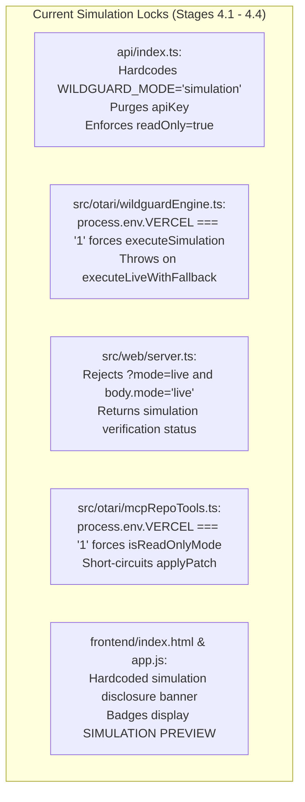
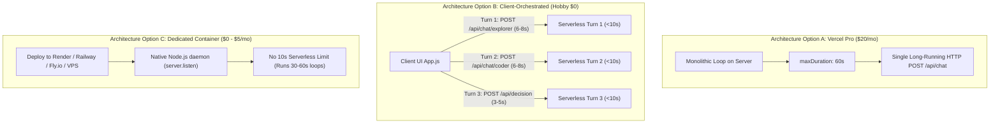
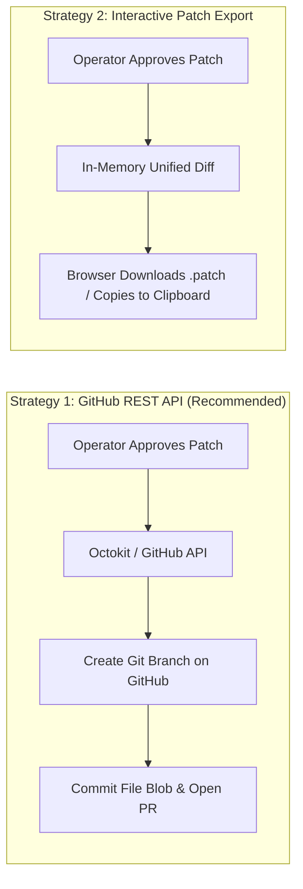
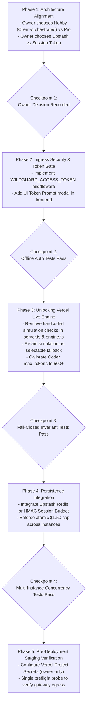

# WildGuard — Stage 4.5 Live Otari + Vercel Migration Audit Report

**Workspace:** `C:\Users\NO GO NO\WILDGUARD`  
**Repository:** `https://github.com/JimmyOgb/wildguard`  
**Branch:** `feat/otari-agent-harness`  
**Base Commit (HEAD):** `26f66e9d84029914e59191585342e554e8cd4123`  
**Execution Timestamp:** 2026-11-02  
**Audit Purpose:** Comprehensive Pre-Migration Architecture & Feasibility Assessment for Genuine Live Otari Inference on Vercel  
**Status:** Read-Only Audit & Planning Only (Zero live network calls; zero credentials accessed or exposed; zero deployments)

---

## 1. Executive Summary & Audit Verdict

### **AUDIT VERDICT: BLOCKED_PENDING_ARCHITECTURE_DECISION**

### Justification:
While WildGuard's core logic, deterministic guardrails, multi-model routing, and simulated workflows are robustly tested (91/91 offline tests passing), migrating from a simulation preview to a **genuine, live Otari-powered Vercel deployment** introduces hard architectural contradictions between serverless runtime constraints and LLM inference requirements:

1. **The 10-Second Vercel Hobby Timeout Wall:**  
   WildGuard's autonomous agent loop (`AgentLoop.run`) executes multiple sequential LLM turns (Explorer $\rightarrow$ Coder $\rightarrow$ Decision Gate). Empirical latency recorded in Stage 3.8 and Stage 3.12 demonstrated that single Otari turns take between 7.3s and 10.8s. A complete autonomous loop takes **20 to 35+ seconds**. On Vercel's Hobby (free) tier, serverless function execution is strictly terminated at **10.0 seconds**, guaranteeing an immediate HTTP 504 `FUNCTION_INVOCATION_TIMEOUT` error on autonomous requests.
2. **Loss of Global Financial & Spending Cap Enforcement:**  
   The $1.50 per-run financial guardrail is currently enforced by an in-memory `TelemetryManager`. In Vercel serverless environments, functions are stateless, ephemeral, and scale horizontally across instances. Each new instance initializes at `$0.000000 USD`. An in-memory manager **cannot enforce a global spending cap across serverless instances**, exposing the owner to unbounded API expenditure if requests are dispatched in parallel.
3. **Missing Ingress Authentication on Paid Endpoints:**  
   The HTTP API currently has zero authentication or rate-limiting. Deploying with a live `OTARI_API_KEY` to a public Vercel URL without an ingress access gate allows any arbitrary internet visitor or automated scraper to trigger paid inference, rapidly exhausting the owner's Otari balance.
4. **Serverless Filesystem Immutability (`EROFS`):**  
   Vercel serverless containers feature a strictly read-only filesystem. Real repository edits cannot be committed or written to local disk via `fs.writeFileSync`. A persistent Git provider integration (e.g., GitHub REST API) or in-memory patch export workflow is required.
5. **Unresolved Upstream Gateway Reachability:**  
   Stage 3.12 live verification targeting `meta-llama/llama-3.3-70b-instruct` failed after 10,829 ms with `fetch failed` (HTTP 503 / socket drop). Egress connectivity from AWS/Vercel serverless IP ranges to `api.otari.ai` remains unverified.

Migration to live inference cannot safely proceed until the project owner makes foundational architectural decisions regarding hosting tier, loop orchestration, ingress authentication, and persistent budget tracking.

---

## 2. Current Architecture & Simulation Locks

The current codebase contains deliberate, defense-in-depth mechanisms that hard-lock Vercel deployments into simulation mode. To enable live inference, each of these locks must be safely replaced with authenticated, validated live paths:



### Exact Inventory of Simulation Locks:
1. **`api/index.ts` (Lines 16–26, 36–40):**
   - Explicitly instantiates the agent with `WILDGUARD_MODE: 'simulation'`.
   - Explicitly purges credentials: `previewAgent.config.apiKey = undefined`.
   - Forces `previewAgent.tools.setReadOnly(true)`.
   - Passes `isPublicPreview: true` to `handleWildGuardRequest()`.
2. **`src/otari/wildguardEngine.ts` (Lines 202, 213–218):**
   - In `execute()`: `if (this.config.mode === 'simulation' || process.env.VERCEL === '1') return this.executeSimulation(request);`.
   - In `executeLiveWithFallback()`: `if (process.env.VERCEL === '1') throw new WildGuardApiError('gateway_error', 'Live inference is strictly prohibited in public preview deployments.');`.
3. **`src/web/server.ts` (Lines 136–142, 199–203, 214, 248–252, 392–404, 446):**
   - Flags `isPreview = Boolean(opts?.isPublicPreview || process.env.VERCEL === '1')`.
   - Enforces `(agent.config as any).mode = 'simulation'` and `agent.config.apiKey = undefined`.
   - Intercepts incoming queries (`?mode=live`) and request bodies (`body.mode === 'live'`), rejecting with HTTP 400 `ValidationError`.
   - In `/api/verify`: Short-circuits if `isPreview`, returning static `verificationStatus: 'simulation'` without outbound network calls.
4. **`src/otari/mcpRepoTools.ts` (Lines 53–55, 278–294):**
   - `isReadOnlyMode()` automatically returns `true` if `process.env.VERCEL === '1'`.
   - In `applyPatch()`: Short-circuits disk writing, returning an in-memory diff preview (`dryRun: true`).
5. **`frontend/index.html` (Lines 11–19):**
   - Persistent `previewBanner` claiming zero-cost simulation mode and zero outbound API calls.
6. **`frontend/app.js` (Lines 93–97, 875–885):**
   - Renders `SIMULATION (PREVIEW)` badges and dry-run patch notifications.

---

## 3. Confirmed Blockers

The following table categorizes the confirmed structural blockers that must be resolved prior to live deployment:

| Blocker ID | Domain | Severity | Blocker Description | Impact on Live Deployment |
| :---: | :--- | :---: | :--- | :--- |
| **B-1** | **Platform Quotas** | **CRITICAL** | Vercel Hobby enforces an absolute **10-second** function duration limit. Multi-turn autonomous loops take **20–35s**. Single inference calls take **7–11s**. | Autonomous loops will **always fail with HTTP 504** on Hobby tier. Even single turns will fail if Otari encounters slight gateway latency. |
| **B-2** | **Financial Security** | **CRITICAL** | In-memory `TelemetryManager` does not persist across Vercel serverless instances or cold starts. | The **$1.50 spending cap is completely bypassed** under concurrent or multi-instance requests. Unbounded financial exposure. |
| **B-3** | **Access Control** | **HIGH** | `/api/chat` and `/api/verify` endpoints have zero ingress authentication or IP rate limiting. | Any public internet visitor or bot can send prompts and consume the owner's paid Otari API credits. |
| **B-4** | **Filesystem Persistence** | **HIGH** | Vercel serverless root filesystem is strictly read-only (`EROFS`). | Agent cannot apply patches, write files, or create local Git branches. |
| **B-5** | **Upstream Connectivity** | **HIGH** | Stage 3.12 verified that `meta-llama/llama-3.3-70b-instruct` dropped connections after 10.8s (`fetch failed`). | Otari gateway availability and egress from AWS/Vercel datacenter IPs to `api.otari.ai` is unverified. |
| **B-6** | **Reasoning Model Token Starvation** | **MEDIUM** | Stage 3.8 verified that `alibaba/qwen-3.5-35b-a3b` consumed 100% of tokens in internal thinking, leaving `message.content` empty. | Coder role completions fail to emit code if `max_tokens` is bounded too tightly. |

---

## 4. Vercel Plan Compatibility & Execution Models

Because Vercel Hobby strictly enforces a **10-second ceiling**, three architectural paths exist to execute live Otari requests:



### Detailed Evaluation of Options:

#### Option A: Vercel Pro Plan (Server-Side Monolithic Loop)
- **Mechanism:** Upgrade the Vercel team/account to Vercel Pro ($20/month per seat). Set `"maxDuration": 60` in `vercel.json`.
- **Pros:** Preserves the existing `AgentLoop.run` server-side orchestration exactly as written.
- **Cons:** **Paid service required ($20/mo minimum)**. If Otari hangs for >60s, it still times out.
- **Feasibility on Hobby:** **0% (Impossible on Hobby)**.

#### Option B: Client-Orchestrated Turn-by-Turn Architecture (Vercel Hobby $0 Compatible)
- **Mechanism:** Refactor `frontend/app.js` and `api/index.ts` so the autonomous loop is orchestrated by the client browser rather than a single monolithic backend function:
  1. Browser calls `POST /api/chat` with `{ role: 'explorer', task }` $\rightarrow$ Serverless function executes only Explorer turn (~7s), returns plan to client.
  2. Browser updates UI progress, calls `POST /api/chat` with `{ role: 'coder', task, plan }` $\rightarrow$ Serverless function executes only Coder turn (~7s), returns patch to client.
  3. Browser calls `POST /api/decisions` with proposed diff $\rightarrow$ Serverless function queries Otari Decision Gate (~4s), returns risk assessment.
  4. Browser prompts operator for approval.
- **Pros:** **100% Free / Works within Vercel Hobby limits (each turn is <10s)**. Streaming UI progress updates naturally.
- **Cons:** If any single model call takes >10 seconds (e.g. Llama taking 10.8s), that turn will still timeout on Hobby. Requires frontend orchestration refactoring.

#### Option C: Alternative Persistent Container Hosting (Render / Railway / Fly.io / VPS)
- **Mechanism:** Deploy WildGuard as a standalone Node.js server (`npm start`) to a persistent container service rather than a serverless platform.
- **Pros:** Preserves `http.createServer().listen()` daemon, native filesystem (on stateful disks), and indefinite execution duration.
- **Cons:** Not Vercel. May incur modest costs ($0 on free tiers like Render/Fly.io, or $5/mo on Railway/Hetzner).

---

## 5. Security & Spending-Control Design for Live Mode

To operate safely in live mode on a public serverless deployment, the following controls must be implemented:

### 5.1 Ingress Authentication (Protection Against Public Abuse)
Before any serverless function invokes Otari, it must verify caller authorization:
- **Design:** Server-side validation of a shared secret token:
  ```typescript
  // Ingress Token Guard
  const authHeader = req.headers['authorization'] || '';
  const expectedToken = process.env.WILDGUARD_ACCESS_TOKEN;
  if (!expectedToken || authHeader !== `Bearer ${expectedToken}`) {
    sendJson(401, { success: false, error: 'Unauthorized: Valid WildGuard Access Token required for live inference.' });
    return;
  }
  ```
- **UI Integration:** The web frontend prompts the operator for the access token on first load, stores it in browser `sessionStorage`, and attaches it to all `/api/*` requests.
- **Cost:** **$0 (Zero external dependencies)**.

### 5.2 Global Atomic Spending Cap Enforcement ($1.50 Hard Cap)
In-memory tracking cannot prevent concurrent or multi-instance overspending. A shared, atomic persistence store is required:

#### Free Options ($0-First):
1. **Upstash Redis (Serverless REST API):**
   - Free Tier: 10,000 commands/day, 256MB storage. **Zero credit card required**.
   - Protocol: Native HTTP/REST via `@upstash/redis` (no persistent TCP connection pools required).
   - Atomic Operations:
     - `INCRBYFLOAT wildguard:spend:global <cost>`
     - Scripted atomic pre-check: Check if `current_spend + projected <= 1.50` before dispatching inference.
2. **Client-Token Micro-Spend Budget (Session-Bounded):**
   - If external databases are rejected, the server signs an HMAC token with current session spend, and the client passes it back on each turn.
   - Limitation: Prevents session overspend, but does not prevent multiple concurrent users from spending $1.50 each.

### 5.3 Live-Mode Credential Isolation
- `OTARI_API_KEY` is configured exclusively in Vercel Project Environment Variables (Encrypted, Server-Side Only).
- Never prefixed with `NEXT_PUBLIC_` or `VITE_`.
- Redaction filters (`sanitizeConfig` and `sanitizeErrorMessage`) remain strictly enforced across all responses and telemetry logs.

---

## 6. Repository & File Safety in Serverless Environments

Because Vercel serverless functions have a read-only filesystem (`EROFS`), local disk editing is fundamentally impossible. Two safe production strategies exist:



### Strategy 1: GitHub REST API Integration (Recommended for Real Coding Agents)
- **Mechanism:** Operator provides a scoped GitHub Personal Access Token (or GitHub App token) via environment variable `GITHUB_TOKEN`.
- **Workflow:**
  1. Explorer and Coder generate the proposed code patch in-memory.
  2. Decision Gate validates security rules.
  3. Operator reviews the diff in the UI and clicks "Approve & Commit".
  4. Serverless function invokes GitHub REST API (`POST /repos/{owner}/{repo}/git/refs` and `POST /repos/{owner}/{repo}/git/commits`).
  5. A real commit is pushed to a feature branch (e.g. `wildguard/patch-xyz`) and a Pull Request is opened automatically.
- **Safety:** Protected branches (`main`/`master`) remain mathematically blocked by `guardrails.ts`. Disk is never touched.

### Strategy 2: In-Memory Diff & Patch Export (Zero Setup / Zero Scope)
- **Mechanism:** Patches are computed entirely in memory.
- **Workflow:** UI displays the unified diff with a "Download .patch File" and "Copy to Clipboard" button.
- **Safety:** Completely safe, zero permissions required, zero risk of repository corruption.

---

## 7. Otari Gateway Connectivity Risks

Empirical findings from Stages 3.8 and 3.12 establish that live Otari connectivity requires specific technical remediations before production deployment:

### 7.1 The Reasoning Model Content Anomaly (Stage 3.8 Finding)
- **Observed Fact:** When calling `alibaba/qwen-3.5-35b-a3b` with `max_tokens: 100`, the upstream model spent 100% of its token allocation generating reasoning/thinking tokens (`reasoning_content`), emitting `""` (empty string) in `message.content`.
- **Remediation for Live Coder:**
  - Increase `max_tokens` for Coder turns to **500–1000 tokens** so the model has sufficient space to finish reasoning and output the actual code patch.
  - Or route Coder role to a non-reasoning instruction model (e.g., `qwen/qwen-2.5-coder-7b` or `meta-llama/llama-3.3-70b-instruct`).

### 7.2 The Transport Socket Drop Anomaly (Stage 3.12 Finding)
- **Observed Fact:** An outbound POST to `https://otari.ai/api/v1/chat/completions` targeting `meta-llama/llama-3.3-70b-instruct` dropped after 10,829 ms with `TypeError: fetch failed` (HTTP 503).
- **Remediation for Live Gateway:**
  - Verify whether `https://api.otari.ai/api/v1` or `https://otari.ai/api/v1` is the canonical production gateway.
  - Ensure client timeout `OTARI_TIMEOUT_MS` is calibrated to the function runtime (e.g., 9,000ms on Hobby, 25,000ms on Pro).
  - Implement a dedicated, controlled preflight diagnostic endpoint (`/api/diag/gateway`) that verifies DNS and TLS handshake before any inference is permitted.

---

## 8. Sequenced Implementation Plan (Pending Approval)

If authorized by the project owner, live migration will proceed through the following phased sequence:



### Detailed Phase Breakdown:

| Phase | Milestone | File Changes Involved | Testing Requirement |
| :---: | :--- | :--- | :--- |
| **1** | **Architecture Decision** | None (Planning & Sign-off) | Confirmation of hosting plan and persistence tier. |
| **2** | **Ingress Authentication** | `src/web/server.ts`, `frontend/app.js`, `frontend/index.html` | Tests verify unauthenticated requests to live endpoints return 401. |
| **3** | **Unlocking Live Engine** | `src/otari/wildguardEngine.ts`, `src/web/server.ts`, `api/index.ts` | Tests verify live mode activates only when explicit key AND auth token are present; fails safe to simulation if absent. |
| **4** | **Atomic Spending Cap** | `src/otari/telemetry.ts` (Storage Adapter interface) | Tests verify parallel concurrent requests cannot exceed $1.50 cap. |
| **5** | **Preflight Connectivity** | `src/web/server.ts` (`/api/verify`) | Single authorized outbound diagnostic request verifying HTTP 200 and non-empty content. |

---

## 9. Decisions Requiring Owner Approval

Before any code modification or live credential configuration can occur, the project owner must review and decide on the following four architectural questions:

### Decision 1: Vercel Hosting Tier vs. Loop Execution Architecture
- **Option 1A (Recommended Free Path):** Maintain Vercel Hobby ($0). Refactor the autonomous loop to be client-orchestrated turn-by-turn so every individual request completes within the 10s serverless limit.
- **Option 1B (Paid Vercel Path):** Upgrade to Vercel Pro ($20/month). Set `maxDuration: 60s` in `vercel.json` and keep the server-side monolithic loop intact.
- **Option 1C (Container Path):** Migrate deployment target from Vercel to a persistent container service (e.g., Render or Fly.io) to run the native Node daemon without serverless timeouts.

### Decision 2: Global Financial Cap Persistence ($1.50 Limit)
- **Option 2A (Recommended Free Path):** Provision an Upstash Redis database (Free tier: 10,000 commands/day, $0 cost, no credit card required) to store atomic spend counters across serverless instances.
- **Option 2B (Session-Token Path):** Enforce the $1.50 cap per browser session using cryptographically signed HMAC cookies/tokens ($0, no external database, but does not prevent multiple concurrent users from spending $1.50 each).

### Decision 3: Ingress Access Gate (Protection Against Credit Drain)
- **Option 3A (Recommended Shared Secret):** Require an operator passphrase (`WILDGUARD_ACCESS_TOKEN`) set in Vercel environment variables before any live Otari API call is authorized.
- **Option 3B (Open Public Live Access):** Allow unauthenticated public live inference (Carries extreme risk of automated credit draining up to the global cap).

### Decision 4: Repository Editing Strategy
- **Option 4A (Recommended):** Real GitHub PR creation via GitHub REST API (`GITHUB_TOKEN`).
- **Option 4B:** In-memory diff review with downloadable `.patch` file export (Read-only disk, $0 setup).

---

## 10. Audit Conclusion

WildGuard has been thoroughly audited for live Otari deployment. The simulation locks established in Stage 4.2 successfully protect the application, but **live deployment cannot safely occur until the project owner selects an execution model (Hobby turn-by-turn vs. Pro 60s) and an ingress protection mechanism.**

**STATUS: BLOCKED_PENDING_ARCHITECTURE_DECISION**

*Audit complete. All security requirements respected. No code altered. No credentials touched. Awaiting project owner guidance on Decisions 1 through 4.*
