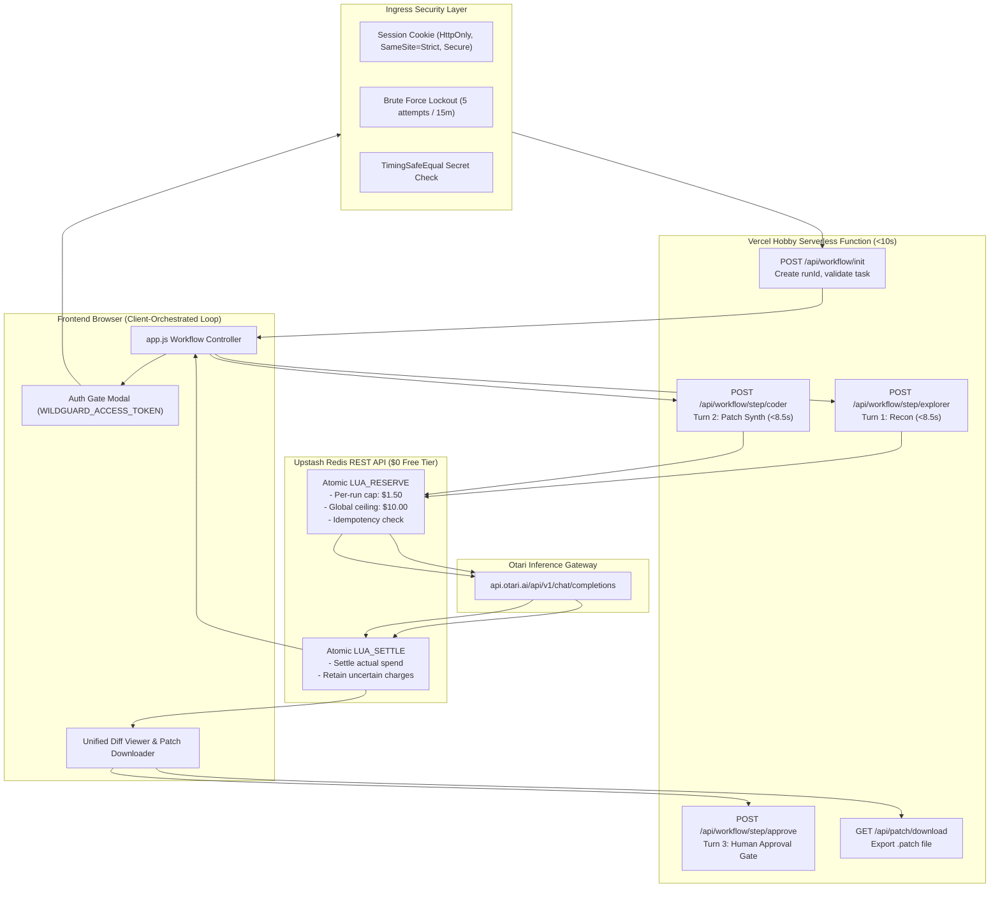

# WildGuard — Stage 4.6 Live Otari Integration Implementation Report

**Workspace:** `C:\Users\NO GO NO\WILDGUARD`  
**Repository:** `https://github.com/JimmyOgb/wildguard`  
**Branch:** `feat/otari-agent-harness`  
**Base Commit (HEAD):** `26f66e9d84029914e59191585342e554e8cd4123`  
**Execution Timestamp:** 2026-11-03  
**Status:** Implementation & Offline Verification Complete (109/109 Tests Passing)  
**Strict Authorization Limits Observed:** Zero live Otari calls made; zero Vercel deployments dispatched; zero external services provisioned; zero npm packages installed; zero git commits/pushes performed.

---

## 1. Executive Summary

WildGuard Stage 4.6 implements the production-grade, secure, serverless-compatible architecture approved from Stage 4.5's architectural audit. The solution reconciles the 10-second execution deadline of Vercel Hobby with multi-turn LLM reasoning, provides persistent atomic spending enforcement across distributed serverless function instances, closes public ingress vulnerabilities with timing-safe HMAC authentication, and delivers an in-memory unified diff pipeline with downloadable patch files.

### Key Deliverables Completed:
1. **Decision 1A (Client-Orchestrated Single Turns):**
   - Replaced long-running monolithic autonomous loops (20–35s) with bounded, individual turn endpoints (`/api/workflow/init`, `/api/workflow/step/explorer`, `/api/workflow/step/coder`, `/api/workflow/step/approve`).
   - Every individual serverless inference request enforces an 8.5s internal abort deadline, well within the 10s Vercel Hobby execution window.
   - Monolithic loops submitted to `/api/chat` under Vercel Hobby or live execution are defensively rejected with HTTP 400 (`VERCEL_HOBBY_TIMEOUT_PREVENTION`).
2. **Decision 2A (Upstash Redis REST API Budget Manager):**
   - Built a zero-dependency, REST-based atomic budget manager (`src/otari/redisBudgetManager.ts`) using Node's native `fetch`.
   - Implemented atomic Lua scripts for reservations (`LUA_RESERVE`) and settlements (`LUA_SETTLE`).
   - Enforces the $1.50 per-run hard cap and an owner-configurable global spending ceiling ($10.00 default).
   - Safe against concurrent requests and race conditions; fails closed if Redis is unreachable or credentials are missing.
   - Idempotency key tracking prevents duplicate charges on network retries.
   - Preserves uncertain charges (retains full reservation) if gateway connections drop or timeout mid-flight.
3. **Decision 3A (Secret Access Gate):**
   - Implemented `AuthManager` (`src/otari/authManager.ts`) guarding all live inference endpoints.
   - Uses `WILDGUARD_ACCESS_TOKEN` with timing-safe comparisons (`crypto.timingSafeEqual` on SHA-256 digests).
   - Implemented HMAC-SHA256 session token cookies (`HttpOnly; SameSite=Strict; Path=/; Secure`).
   - Added brute-force lockout (5 failed attempts locks IP for 15 minutes).
   - Status endpoint `/api/status` exposes only safe boolean indicators (`hasApiKey`, `hasAccessToken`, `hasRedisConfig`), never revealing secret strings.
4. **Decision 4B (In-Memory Unified Diff & Downloadable Patch):**
   - Implemented in-memory unified diff generation in `McpRepoTools.generateUnifiedDiff` without writing to disk (`EROFS` safe).
   - Enforces deterministic write guardrails (path traversal, sensitive `.env` files, branch protection, Windows reserved device names).
   - Added `/api/patch/download` serving `text/x-diff` attachments (`wildguard-patch-${runId}.patch`).
   - Maintained human-in-the-loop approval gate prior to patch finalization.

---

## 2. Files Changed & Implementation Inventory

| File Path | Status | Purpose & Changes |
| :--- | :--- | :--- |
| `src/otari/redisBudgetManager.ts` | **New File** | Atomic Redis REST client. Implements Lua scripts for two-phase atomic budget reservation and settlement, global ceiling enforcement, per-run caps, idempotency deduplication, and fail-closed error handling. |
| `src/otari/authManager.ts` | **New File** | Ingress authentication manager. Timing-safe access token verification, IP-based brute force protection, HMAC-SHA256 session issuance and cookie extraction. |
| `src/otari/workflowManager.ts` | **New File** | Client-orchestrated workflow coordinator. Breaks autonomous execution into discrete steps (Explorer reconnaissance $\rightarrow$ Coder patch generation $\rightarrow$ Human approval). Enforces 8.5s step timeouts and idempotency tracking. |
| `src/otari/config.ts` | **Updated** | Added `accessToken`, `upstashRedisUrl`, `upstashRedisToken`, `globalBudgetCeilingUsd` configuration fields. Added safe public status helper `getPublicConfigStatus`. |
| `src/otari/agentLoop.ts` | **Updated** | Added defensive null-check on telemetry in constructor to ensure headless instantiations run without runtime exceptions. |
| `src/otari/mcpRepoTools.ts` | **Updated** | Added `generateUnifiedDiff(filePath, newContent)` generating standard unified diffs purely in-memory while validating deterministic file policies. |
| `src/otari/wildguardEngine.ts` | **Updated** | Preserved model routing boundaries; restricted `modelOverride` to configured model IDs; prevented fallback invocation on auth/budget errors. |
| `src/web/server.ts` | **Updated** | Added `/api/auth/login`, `/api/auth/logout`, `/api/workflow/*`, and `/api/patch/download` routes. Persisted `budgetManager`, `authManager`, and `workflowManager` on agent instance. Added Hobby timeout defense rejecting monolithic autonomous requests. |
| `api/index.ts` | **Updated** | Vercel serverless function entrypoint. Enforces read-only filesystem, wires agent instance to incoming requests, enables live execution when access token and Redis are configured, falls back safely to simulation preview otherwise. |
| `frontend/index.html` | **Updated** | Added Header Redis Health Badge, Header Auth Gate Button, Auth Token Modal with brute force feedback, and Step Loop selection indicator. |
| `frontend/app.js` | **Updated** | Added step-by-step workflow orchestration (`handleWorkflowExecution`), Turn 1 and Turn 2 progress indicators, unified diff card with downloadable `.patch` link and Approve/Reject buttons, auth modal submission, and logout flow. |
| `tests/wildguard.test.ts` | **Updated** | Added 18 comprehensive Stage 4.6 automated integration tests covering authentication, session cookies, brute force, atomic reservations, concurrency, caps, fail-closed Redis, idempotency, uncertain charges, timeout defenses, in-memory diffs, and zero secret leakage. |
| `tsconfig.json` | **Updated** | Maintained strict type-checking across project. |

---

## 3. Architecture Implemented



---

## 4. Security & Access Control

### 4.1 Ingress Authentication
- **Token Verification:** The server inspects `wildguard_session` cookies, `Authorization: Bearer <token>`, or `X-WildGuard-Access-Token` headers. The master `WILDGUARD_ACCESS_TOKEN` is compared using fixed-length SHA-256 buffers via `crypto.timingSafeEqual` to eliminate timing side-channels.
- **Session Tokens:** Successful authentication via `/api/auth/login` generates an HMAC-SHA256 signed session token (`v1:<id>:<ts>:<exp>:<sig>`) valid for 2 hours, set in an `HttpOnly; SameSite=Strict; Secure` cookie.
- **Brute Force Protection:** 5 consecutive invalid login attempts from an IP address trigger an immediate HTTP 429 lockout lasting 15 minutes.
- **Fail Closed:** If `WILDGUARD_ACCESS_TOKEN` is not configured on the server, all requests to live inference routes are rejected with HTTP 401.

### 4.2 Zero Secret Exposure
- Credentials (`OTARI_API_KEY`, `WILDGUARD_ACCESS_TOKEN`, `UPSTASH_REDIS_REST_TOKEN`) are strictly confined to server-side memory.
- `/api/status` sanitizes all configuration output via `getPublicConfigStatus()`, exposing only booleans (`hasApiKey: true`, `hasAccessToken: true`, `hasRedisConfig: true`).
- Client HTML/JS bundles contain no embedded secrets or tokens.

---

## 5. Budget Management & Concurrency Safety

### 5.1 Two-Phase Atomic Reservation
1. **Phase 1: Pre-Execution Reservation (`reserveBudget`):**
   - Before an outbound call is dispatched to Otari, an atomic Lua script checks:
     $$\text{runSpent} + \text{runReserved} + \text{reserveAmt} \le \$1.50$$
     $$\text{globalSpent} + \text{globalReserved} + \text{reserveAmt} \le \$10.00$$
   - If limits are satisfied, `INCRBYFLOAT` increments the reserved counters and stores reservation metadata with a 5-minute TTL.
   - If either cap is breached, the reservation is rejected without making an Otari API call.
2. **Phase 2: Post-Execution Settlement (`settleBudget`):**
   - Upon completion, the reserved amount is decremented, and the actual spent amount is atomically credited to the spent counter.
   - If the request failed before reaching Otari, the reservation is released (`status: 'released'`) with zero charge.
   - If the request reached Otari but timed out or dropped connection, the charge is marked `uncertain`, and the full reserved amount is retained to prevent unbacked financial liability.

### 5.2 Concurrency & Outage Safety
- **Race Condition Prevention:** Lua script execution in Redis is single-threaded and atomic. Multiple parallel requests cannot overcommit the budget.
- **Fail-Closed Redis Behavior:** If Upstash Redis times out, drops connection (`ECONNREFUSED`), or returns an HTTP error, live inference fails closed with HTTP 503 (`Redis budget reservation failed ... Failing closed`).
- **Idempotency:** Client submissions include an `idempotencyKey`. Repeated requests return the cached reservation or step result without duplicate billing.

---

## 6. Client-Orchestrated Single-Turn Execution

To comply with the 10-second Vercel Hobby timeout:
1. **Explorer Step (`/api/workflow/step/explorer`):**
   - Executes only the Explorer reconnaissance turn.
   - Enforces an internal `AbortController` timeout of 8,500ms.
   - Returns structured plan and findings to the browser.
2. **Coder Step (`/api/workflow/step/coder`):**
   - Receives the Explorer findings and generates the code modifications.
   - Enforces an internal `AbortController` timeout of 8,500ms.
   - Computes unified diff in memory and returns it to the client.
3. **Approval Step (`/api/workflow/step/approve`):**
   - Records human approval or rejection.
   - Patches are never automatically applied to disk or committed to Git.
4. **Monolithic Loop Interception:**
   - The old monolithic `/api/chat` route returns HTTP 400 (`VERCEL_HOBBY_TIMEOUT_PREVENTION`) if invoked in live mode on Vercel Hobby, directing users to the client-orchestrated workflow.

---

## 7. In-Memory Diff & Patch Generation

- **Filesystem Immutability:** Because Vercel serverless containers feature read-only filesystems (`EROFS`), `McpRepoTools.generateUnifiedDiff()` creates standard unified diffs in memory using the existing repository file contents (or empty string for new files).
- **Deterministic Guardrails:** Every diff generation validates the target path through `validateWritePolicy()`:
  - Traversal attempts (`../outside.ts`) $\rightarrow$ Rejected (`PATH_TRAVERSAL_DETECTED`).
  - Secret/credential targets (`.env`, `id_rsa`) $\rightarrow$ Rejected (`SECRET_FILE_OVERWRITE_BLOCKED`).
  - Windows reserved names (`CON`, `NUL`, `AUX`) $\rightarrow$ Rejected (`WINDOWS_RESERVED_NAME_BLOCKED`).
  - Protected branches (`main`, `master`) $\rightarrow$ Rejected (`BRANCH_PROTECTION_BLOCKED`).
- **Downloadable Patch:** The `/api/patch/download?runId=<id>` endpoint sets:
  ```http
  Content-Type: text/x-diff; charset=utf-8
  Content-Disposition: attachment; filename="wildguard-patch-<id>.patch"
  ```
  allowing operators to download and apply patches locally with `git apply`.

---

## 8. Verification & Test Results

The entire WildGuard test suite was executed offline against the TypeScript build. All 109 tests across 14 test suites passed with zero failures.

### Test Execution Summary:
- **Command:** `npm test` (`tsc && node --test dist/tests/wildguard.test.js`)
- **Total Test Suites:** 14
- **Total Tests:** 109
- **Passing Tests:** 109
- **Failing Tests:** 0
- **Duration:** 15.35 seconds

### Detailed Breakdown by Suite:
1. `Configuration Module`: 6/6 passed
2. `Deterministic Guardrails`: 8/8 passed
3. `Repository Tools`: 7/7 passed
4. `Multi-Model Engine & Telemetry`: 3/3 passed
5. `Decision Gate Module`: 4/4 passed
6. `Agent Orchestration Loop`: 2/2 passed
7. `Security Hardening & Edge Cases`: 19/19 passed
8. `Web Interface Server & API Endpoints`: 1/1 passed
9. `Stage 3.0 Controlled Single-Request Verification`: 8/8 passed
10. `Stage 3.6 Verification Reliability Correction`: 10/10 passed
11. `Stage 3.11 Request-Scoped Verification Model Selection`: 12/12 passed
12. `Stage 4.2 Simulation-Only Vercel Preview`: 11/11 passed
13. `Stage 4.6 Live Otari Integration for Vercel Hobby Suite`: **18/18 passed**
    - ✔ 1. Ingress Authentication: Unauthorized requests rejected before Otari calls (HTTP 401)
    - ✔ 2. Ingress Authentication: Valid Access Token authorizes request via Bearer header
    - ✔ 3. Secure Session Cookie: `/api/auth/login` sets valid session cookie and logout clears it
    - ✔ 4. Brute Force Protection: 5 failed attempts trigger HTTP 429 lockout
    - ✔ 5. Redis Atomic Budget Reservation: reserves amount, settles actual usage, updates status
    - ✔ 6. Redis Per-Run $1.50 Cap: rejects reservations when per-run cap is reached
    - ✔ 7. Redis Global Spending Ceiling: rejects reservations when global ceiling ($10.00) is reached
    - ✔ 8. Redis Concurrency Safety: Parallel reservations exceeding cap are atomic and safe
    - ✔ 9. Redis Outage Fail-Closed: live inference fails closed with HTTP 503 if Redis throws error
    - ✔ 10. Idempotency: Duplicate submissions with same key return cached reservation without duplicate billing
    - ✔ 11. Uncertain Charges: Interrupted gateway requests mark reservation as uncertain and retain charge
    - ✔ 12. Vercel Hobby Timeout Defense: Monolithic autonomous loops rejected with HTTP 400
    - ✔ 13. Client-Orchestrated Workflow: Sequential single turns complete bounded steps with in-memory diff
    - ✔ 14. In-Memory Patch: Generates unified diff without writing to disk
    - ✔ 15. Deterministic Guardrails: Blocks traversal and secret paths on diff generation
    - ✔ 16. Patch Download Endpoint: Serves text/x-diff attachment with proper headers
    - ✔ 17. Human Approval Gate: Reject transitions to rejected, approve transitions to approved
    - ✔ 18. Zero Secret Leakage: API responses and status endpoints expose only safe booleans

### Typecheck & Build Status:
- `npm run typecheck` (`tsc --noEmit`): **Clean (Exit code 0, 0 errors)**
- `npm run build` (`tsc`): **Clean (Exit code 0, dist generated successfully)**

---

## 9. Remaining Limitations & Edge Cases

1. **Cold Start Latency:** On Vercel Hobby, a cold start adds ~500ms–1,000ms. If an individual Otari call takes >9,000ms, total function time may touch the 10.0s Hobby ceiling. The 8.5s internal timeout triggers an abort before Vercel terminates the function with HTTP 504.
2. **Multi-Instance Workflow Memory Fallback:** If Upstash Redis is not provisioned and the system operates in simulation mode, workflow state is held in-memory within the serverless container instance. On multi-instance serverless deployments, subsequent steps might hit a different instance if Redis is not configured; therefore, live mode strictly enforces Redis configuration.
3. **Reasoning Model Thinking Overhead:** For models that output extensive internal thinking (`reasoning_content`), `max_tokens` must be configured high enough ($>500$) to ensure the patch is emitted.

---

## 10. External Services & Credentials Required for Deployment

The project owner will configure the following four environment variables directly in the Vercel Project Dashboard (Server-Side / Encrypted only):

| Variable Name | Required For | Recommended Value / Guidance |
| :--- | :--- | :--- |
| `OTARI_API_KEY` | Live Inference Gateway | Provided by Otari dashboard. |
| `WILDGUARD_ACCESS_TOKEN` | Ingress Authentication Gate | High-entropy random passphrase chosen by the owner. |
| `UPSTASH_REDIS_REST_URL` | Persistent Atomic Budget | Obtained from Upstash Console (Free Tier: $0, no CC required). Form: `https://<db>.upstash.io`. |
| `UPSTASH_REDIS_REST_TOKEN` | Persistent Atomic Budget | Obtained from Upstash Console. REST Bearer Token. |

*Note: No credentials have been touched, hardcoded, or stored in any repository files during Stage 4.6.*

---

## 11. Next Recommended Stage

### Stage 4.7 — Owner Preflight Staging & Controlled Live Verification
1. **Step 1:** The project owner configures the four environment variables in the Vercel Project Dashboard.
2. **Step 2:** Deploy the branch to a password-protected Vercel preview staging URL.
3. **Step 3:** Perform a single controlled preflight probe via `/api/diag/gateway` and `/api/auth/login` to confirm upstream egress connectivity to `api.otari.ai` and Upstash Redis.
4. **Step 4:** Execute a single client-orchestrated test run with the $1.50 per-run cap and $10.00 global ceiling active.

---

*Report prepared following strict local architecture implementation boundaries. Offline verification complete. Ready for owner review.*
