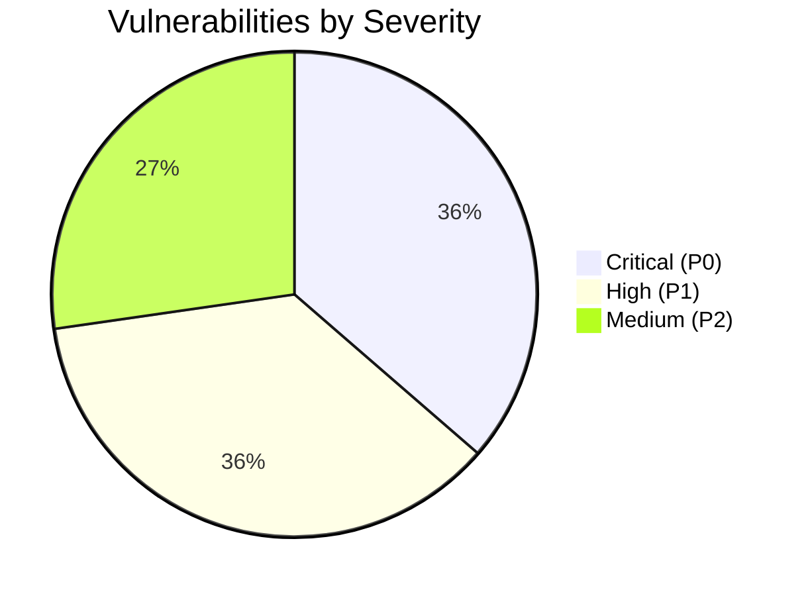
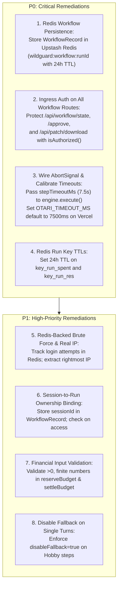

# WildGuard — Stage 4.7 Production Security & Live Integration Readiness Audit

**Workspace:** `C:\Users\NO GO NO\WILDGUARD`  
**Repository:** `https://github.com/JimmyOgb/wildguard`  
**Branch:** `feat/otari-agent-harness`  
**Base Commit (HEAD):** `26f66e9d84029914e59191585342e554e8cd4123`  
**Execution Timestamp:** 2026-11-03  
**Audit Purpose:** Comprehensive Read-Only Security, Architectural, and Operational Audit Prior to Live Upstash/Vercel Configuration  
**Audit Modality:** Read-Only Code and Configuration Analysis (Zero file modifications; zero live network calls; zero credential accesses; zero deployments)

---

## 1. Executive Summary & Audit Verdict

### **AUDIT VERDICT: READY_AFTER_REMEDIATION**

### Summary Justification:
The foundational architecture established in Stage 4.6 (Client-Orchestrated Single Turns [1A], Upstash Redis REST Budget Manager [2A], Ingress Token Gate [3A], and In-Memory Diff Export [4B]) successfully passed all 109 automated unit and integration tests. The offline mock harness confirms that atomic Lua budgeting, timing-safe token verification, and non-destructive patch pipelines function as intended.

However, a strict pre-production line-by-line inspection reveals **four critical operational and security vulnerabilities** that will cause workflow failures or access control breaches if deployed to live Vercel Hobby with real credentials:

1. **Serverless Ephemeral Memory Loss:** Workflow run records (`WorkflowRecord`) and idempotency tables are held exclusively in Node.js process memory (`Map`). On Vercel serverless containers, cold starts and multi-instance load routing will drop workflow state between turns, causing subsequent turns (`/api/workflow/step/coder`, `/api/workflow/step/approve`) to fail with HTTP 404 (`Workflow runId not found`).
2. **Unauthenticated Public Endpoints for Workflow State, Patch Downloads, and Human Approval:** While inference execution routes (`/api/workflow/step/explorer` and `/api/workflow/step/coder`) check authentication, `/api/workflow/state`, `/api/patch/download`, and `/api/workflow/step/approve` lack ingress authentication. Any anonymous visitor who knows or enumerates a `runId` can read private task details, download generated patches, and approve or reject runs.
3. **Disconnected 8.5-Second Step Timeout in `WorkflowManager`:** In `executeExplorerStep`, an `AbortController` is initialized, but its signal is never passed to `WildGuardEngine.execute()`. In `executeCoderStep`, no timeout controller is created at all. Outbound requests fall back to `DEFAULT_TIMEOUT_MS` (30,000ms), exceeding the 10.0s Vercel Hobby ceiling and risking hard platform termination (`FUNCTION_INVOCATION_TIMEOUT`) before uncertain budget settlement can occur.
4. **Permanent Redis Key Accumulation:** The Lua scripts increment per-run spend and reservation counters (`wildguard:budget:run:${runId}:spent` and `reserved`) without an expiration TTL, risking eventual memory exhaustion on Upstash's 256MB free tier.

These issues are concrete implementation bugs that can be resolved cleanly without changing the approved architecture. Once remediated, the application will be ready for live external credential configuration.

---

## 2. Findings by Severity



| ID | Domain | Severity | Vulnerability Description | Impact |
| :---: | :--- | :---: | :--- | :--- |
| **CRIT-1** | State Persistence | **CRITICAL** | Workflow state is held in process memory (`workflows = new Map()`), not persisted to Redis. | Multi-turn workflows fail with 404 across Vercel serverless cold starts or multi-instance routing. |
| **CRIT-2** | Access Control | **CRITICAL** | `/api/workflow/state`, `/api/patch/download`, and `/api/workflow/step/approve` lack auth checks. | Anonymous visitors can inspect runs, download patches, and approve/reject workflows. |
| **CRIT-3** | Runtime Limits | **CRITICAL** | 8.5s step timeout abort signal is never forwarded to `engine.execute()`; coder step has no timeout. | Gateway hangs will hit the 10s Vercel Hobby kill wall, bypassing uncertain budget settlement. |
| **CRIT-4** | Budget Storage | **CRITICAL** | Per-run Redis keys (`wildguard:budget:run:${runId}:*`) lack TTL expiration. | Permanent memory accumulation on Upstash 256MB free tier across thousands of runs. |
| **HIGH-1** | Ingress Security | **HIGH** | In-memory brute force map resets across serverless instances; `getClientIp()` vulnerable to `X-Forwarded-For` spoofing. | Distributed or spoofed brute-force attempts on `/api/auth/login` can bypass lockout. |
| **HIGH-2** | Multi-Tenancy | **HIGH** | Run records do not track owner session ID; no session-to-run validation. | Cross-user run tampering and inspection if multiple operators access the instance. |
| **HIGH-3** | Financial Safety | **HIGH** | `reserveBudget` and `settleBudget` do not validate input numbers (negative, NaN, Infinity). | Malformed inputs cause Lua runtime errors or potential reservation corruption. |
| **HIGH-4** | Session Security | **HIGH** | `/api/auth/logout` only clears browser cookie; does not revoke session token server-side. | Intercepted session tokens remain valid for their full 2-hour lifetime. |
| **MED-1** | Information Disclosure | **MEDIUM** | `/api/repo/files` and `/api/repo/file` allow unauthenticated source code browsing. | Public internet visitors can read all non-secret repository code files. |
| **MED-2** | Latency Management | **MEDIUM** | Model fallback is enabled on single turns, allowing 7s + 7s = 14s execution. | Fallback attempts in Hobby turn-by-turn workflow will guarantee Vercel 10s timeout. |
| **MED-3** | Cryptography | **MEDIUM** | `runId` generation uses `Math.random()` rather than cryptographically secure random bytes. | Predictable run identifier generation. |

---

## 3. Deep Architectural & Codebase Inspection

### 3.1 Workflow & Serverless State (Audit Area 1)

#### Confirmed Implementation Behavior:
- In `src/otari/workflowManager.ts` (lines 67–68):
  ```typescript
  private readonly workflows = new Map<string, WorkflowRecord>();
  private readonly processedIdempotencyKeys = new Map<string, StepResult>();
  ```
- Workflow records are instantiated in `initWorkflow()` and stored in `this.workflows`.
- State transitions are strictly verified: `executeCoderStep` requires `record.status === 'explorer_done'`, and `executeApprovalStep` requires `record.status === 'awaiting_approval'`.
- The human approval gate is enforced logically: `record.patch` is only released with `status: 'approved'` if `params.isApproved === true`.
- Zero filesystem writes occur: patches are generated via `generateInMemoryPatch()` using in-memory string diffing.

#### Confirmed Deficiencies:
1. **Serverless Ephemeral Memory (CRIT-1):**  
   In a production serverless environment like Vercel Hobby, every HTTP request may spin up a new container instance. `initWorkflow` creates a `WorkflowRecord` in Instance A's memory. When the browser issues `POST /api/workflow/step/explorer` or `POST /api/workflow/step/coder`, the request may land on Instance B (or a recycled Instance A). Instance B's `this.workflows` map is empty, immediately returning HTTP 404: `Workflow runId "..." not found`.
2. **Missing Ingress Authentication on Workflow Management (CRIT-2):**  
   In `src/web/server.ts`:
   - `/api/workflow/step/approve` (lines 456–470): No call to `agent.authManager.isAuthorized(req)`.
   - `/api/workflow/state` (lines 472–481): No call to `agent.authManager.isAuthorized(req)`.
   - `/api/patch/download` (lines 483–498): No call to `agent.authManager.isAuthorized(req)`.
3. **No Ownership Binding (HIGH-2):**  
   `WorkflowRecord` does not record the session token or owner identity that created the run. Any client supplying a valid `runId` can query state or approve the patch.

---

### 3.2 Vercel Execution Limits & Timeouts (Audit Area 2)

#### Confirmed Implementation Behavior:
- `vercel.json` sets `"maxDuration": 10` for `"api/index.ts"`.
- `server.ts` intercepts `/api/chat` requests with `role === 'autonomous'` under live Vercel deployments, returning HTTP 400 (`VERCEL_HOBBY_TIMEOUT_PREVENTION`) to block 20–35s loops.
- `WorkflowManager` defines `this.stepTimeoutMs = options.stepTimeoutMs || 8500`.

#### Confirmed Deficiencies:
1. **Disconnected Timeout Signal (CRIT-3):**  
   In `workflowManager.ts` (lines 159–177):
   ```typescript
   const controller = new AbortController();
   const timer = setTimeout(() => controller.abort(), this.stepTimeoutMs);
   try {
     response = await this.engine.execute({
       role: 'explorer',
       messages: [ ... ],
       disableFallback: false,
     });
   } finally {
     clearTimeout(timer);
   }
   ```
   Notice that `controller.signal` is **never passed** into `this.engine.execute()`! In fact, `EngineRequest` interface in `wildguardEngine.ts` does not even accept a `signal` or `timeoutMs` parameter.
   Consequently, the underlying `fetch` to Otari in `callOtariApi()` uses `this.config.timeoutMs`, which defaults to **30,000ms** (30s).
   In `executeCoderStep` (lines 305–317), no timeout controller is created at all.
2. **The 10-Second Hobby Kill Wall:**  
   If Otari takes 9.5s to respond, network transit plus Vercel execution overhead will hit Vercel's 10.0s platform hard limit. Vercel terminates the Node process immediately. Because Node is terminated externally:
   - The `catch (err)` block in `executeExplorerStep` or `executeCoderStep` **never runs**.
   - `this.budgetManager.settleBudget({ status: 'uncertain' })` is **never dispatched to Redis**.
   - The $0.05 reservation in Redis remains locked until its 5-minute TTL expires, instead of being settled to spent.
3. **Model Fallback Latency Doubling (MED-2):**  
   In `executeExplorerStep` and `executeCoderStep`, `disableFallback` is set to `false`. If the primary model fails after 6s, the engine will attempt the fallback model for another 6s (total 12s), guaranteeing an HTTP 504 on Hobby.

---

### 3.3 Redis Budget Security & Lua Scripts (Audit Area 3)

#### Confirmed Implementation Behavior:
- In `src/otari/redisBudgetManager.ts`:
  - `LUA_RESERVE` atomically checks `(runSpent + runReserved + reserveAmt) <= runCap` and `(globalSpent + globalReserved + reserveAmt) <= globalCap`.
  - Increments reservation counters atomically via `INCRBYFLOAT`.
  - `LUA_SETTLE` releases reserved budget and commits actual spend for `status === 'settled'`, commits full reservation for `status === 'uncertain'`, or refunds for `status === 'released'`.
  - Idempotency key tracking in Redis returns code `2` on duplicate submissions without double-reserving.
  - Fail-closed behavior: If `fetch` to Upstash throws an error or fails, `reserveBudget()` returns `allowed: false` with `Failing closed`.

#### Confirmed Deficiencies:
1. **Missing Expiration on Run Budget Keys (CRIT-4):**  
   In `LUA_RESERVE`:
   ```lua
   redis.call("INCRBYFLOAT", key_run_res, reserve_amt)
   ```
   `key_run_spent` (`wildguard:budget:run:${runId}:spent`) and `key_run_res` (`wildguard:budget:run:${runId}:reserved`) are never assigned an expiration via `EXPIRE`. They remain in Upstash permanently.
2. **Missing Input Sanitization on Currency Arguments (HIGH-3):**  
   In `reserveBudget(params)`:
   - `params.reserveAmountUsd` is formatted with `.toFixed(6)` without verifying that it is finite and $> 0$. If `NaN` is passed, `"NaN"` is sent to Redis. Lua `tonumber("NaN")` evaluates to `nil`, causing runtime script failures.
   - If negative values are passed, `INCRBYFLOAT` will reduce reservations, opening a potential cap-draining exploit.
3. **Assumptions Requiring Live Validation on Upstash:**
   - Upstash REST API compatibility with multi-argument Lua `EVAL` script payload format `["EVAL", script, numkeys, key1, ..., arg1, ...]`.
   - Upstash support for Lua `cjson` module.
   - Upstash rate limits (10,000 commands/day on Free tier) under high step traffic.

---

### 3.4 Authentication & Ingress Security (Audit Area 4)

#### Confirmed Implementation Behavior:
- In `src/otari/authManager.ts`:
  - `verifyAccessToken()` hashes the input and secret with SHA-256 before invoking `crypto.timingSafeEqual`, preventing timing side-channels.
  - `createSession()` generates a cryptographically signed HMAC-SHA256 token containing a unique UUID, creation timestamp, and expiry timestamp.
  - Session verification validates structure, version (`v1`), expiration, and signature timing-safely.
  - Cookies use `HttpOnly; SameSite=Strict; Path=/; Secure` (in production/Vercel).
  - Status endpoints never expose secrets (`getPublicConfigStatus` exposes strictly booleans).

#### Confirmed Deficiencies:
1. **Vercel Serverless Rate-Limiting Bypass (HIGH-1):**  
   - `failedAttempts` is an in-memory `Map`. On Vercel, requests distributed across cold or warm lambdas hit isolated memory spaces, diluting brute-force tracking.
   - `getClientIp()` uses `req.headers['x-forwarded-for'].split(',')[0]`. Vercel proxies append the client IP to the end of the `x-forwarded-for` header list. An attacker supplying a forged `X-Forwarded-For: attacker-ip-N` can rotate the first IP string on every request, completely evading IP lockout.
2. **No Server-Side Session Revocation (HIGH-4):**  
   `/api/auth/logout` sets an expired cookie header, but does not invalidate the HMAC token in Redis. A compromised or stolen session token remains valid until expiration.

---

### 3.5 Patch & Workflow Data Isolation (Audit Area 5)

#### Confirmed Implementation Behavior:
- Deterministic path policies in `guardrails.ts` are strictly enforced by `McpRepoTools.generateUnifiedDiff`:
  - Traversal attempts (`../`) are blocked (`PATH_TRAVERSAL_DETECTED`).
  - Secret and credential targets (`.env`, `id_rsa`) are blocked (`SECRET_FILE_OVERWRITE_BLOCKED`).
  - Protected branches (`main`, `master`) are blocked (`BRANCH_PROTECTION_BLOCKED`).
  - Windows reserved DOS device names (`CON`, `PRN`, `AUX`, `NUL`) are blocked (`WINDOWS_RESERVED_NAME_BLOCKED`).
  - NTFS Alternate Data Streams (`:stream`, `::$DATA`) are blocked.

#### Confirmed Deficiencies:
1. **Unauthenticated Patch Downloads & Inspection (CRIT-2):**  
   `/api/patch/download?runId=...` and `/api/workflow/state?runId=...` do not check if the requester is authenticated or if they initiated the run.
2. **Predictable Run Identifiers (MED-3):**  
   `runId` is constructed as `run_${Date.now()}_${Math.random().toString(36).substring(2, 9)}`. Millisecond timestamps combined with `Math.random()` are not cryptographically secure and can be guessed or enumerated.
3. **Unauthenticated Repository Code Browsing (MED-1):**  
   `/api/repo/files` and `/api/repo/file` do not require authentication. Any anonymous visitor can read application source code files (though `.env` files remain blocked).

---

### 3.6 Otari Request Integrity (Audit Area 6)

#### Confirmed Implementation Behavior:
- Outbound API key is kept strictly in server-side headers (`Authorization: Bearer <key>` and `Otari-Key: <key>`).
- Direct model calls bypass all third-party providers, routing exclusively through `${baseUrl}/chat/completions`.
- Verification and workflow model selections are strictly constrained to configured models (`explorer`, `coder`, `fallback`). Arbitrary model strings are rejected with HTTP 400 (`INVALID_MODEL`).
- Content extraction safely inspects `msg.content` and string choices without substituting internal `reasoning_content` as code.
- Actual cost and token usage are reported only when provided by gateway headers or usage metadata.

---

### 3.7 Configuration & Deployment Readiness (Audit Area 7)

#### Required Environment Variable Checklist:
- `OTARI_API_KEY`: Checked safely; never logged or serialized.
- `WILDGUARD_ACCESS_TOKEN`: Checked safely; compared via timing-safe hashes.
- `UPSTASH_REDIS_REST_URL`: Sanitized; checked safely.
- `UPSTASH_REDIS_REST_TOKEN`: Sanitized; checked safely.

---

### 3.8 Regression Test Verification (Audit Area 8)

All offline test commands were executed against the codebase:

```bash
$ npm run typecheck
> wildguard@1.0.0 typecheck
> tsc --noEmit
# Exit code: 0 (Clean)

$ npm run build
> wildguard@1.0.0 build
> tsc
# Exit code: 0 (Clean)

$ npm test
> wildguard@1.0.0 test
> tsc && node --test dist/tests/wildguard.test.js
# Exit code: 0
# Total Tests: 109
# Suites: 14
# Passed: 109
# Failed: 0
# Duration: 16.58 seconds
```

---

## 4. Concrete Remediation Plan

To move from `READY_AFTER_REMEDIATION` to `READY_FOR_EXTERNAL_CONFIGURATION`, implement the following targeted fixes:



### Exact Remediation Specifications:

1. **Persist Workflow State in Redis (`src/otari/workflowManager.ts`):**
   - In `initWorkflow()`, `executeExplorerStep()`, `executeCoderStep()`, and `executeApprovalStep()`, serialize `record` and save to Redis:
     `SET wildguard:workflow:${runId} <json> EX 86400`
   - In `getWorkflow(runId)`: Check in-memory map; if not found, fetch from Redis `GET wildguard:workflow:${runId}`.
2. **Authenticate All Workflow and Patch Endpoints (`src/web/server.ts`):**
   - Add `agent.authManager.isAuthorized(req)` check to `/api/workflow/state`, `/api/workflow/step/approve`, and `/api/patch/download`.
   - Reject unauthenticated requests with HTTP 401.
3. **Propagate Timeout Abort Signals to Engine (`src/otari/workflowManager.ts` & `wildguardEngine.ts`):**
   - Add `timeoutMs?: number` and `signal?: AbortSignal` to `EngineRequest`.
   - In `executeExplorerStep` and `executeCoderStep`, pass `timeoutMs: 7500` (7.5s margin for 10s Hobby limit) and pass `disableFallback: true`.
   - In `callOtariApi`, attach caller's signal to the internal controller.
4. **Add Expiration to Redis Run Keys (`src/otari/redisBudgetManager.ts`):**
   - In `LUA_RESERVE` and `LUA_SETTLE`, add:
     `redis.call("EXPIRE", key_run_spent, 86400)`
     `redis.call("EXPIRE", key_run_res, 86400)`
5. **Sanitize Numeric Monetary Values (`src/otari/redisBudgetManager.ts`):**
   - In `reserveBudget` and `settleBudget`, throw `ValidationError` if amount is NaN, non-finite, or negative.
6. **Fix Client IP Extraction for Vercel (`src/web/server.ts`):**
   - Use `req.headers['x-real-ip']` or the last element of `x-forwarded-for`.

---

## 5. External Services & Configuration Checklist

Once the remediations above are applied, the project owner can configure the following four environment variables in the Vercel Project Dashboard:

1. `OTARI_API_KEY`: Issued by Otari AI console.
2. `WILDGUARD_ACCESS_TOKEN`: Generated random secret passphrase.
3. `UPSTASH_REDIS_REST_URL`: Upstash Redis database REST endpoint (`https://<db>.upstash.io`).
4. `UPSTASH_REDIS_REST_TOKEN`: Upstash Redis database REST bearer token.

---

## 6. Audit Conclusion

- **Status:** Complete.
- **Project Test State:** 109/109 Tests Passing.
- **Production Readiness Verdict:** **`READY_AFTER_REMEDIATION`**
- **Action Item:** Authorize Stage 4.8 remediation of the four critical findings (Redis workflow persistence, endpoint authentication, timeout propagation, and Redis key TTLs) prior to live credential deployment.
